<p align="center">
  <picture>
    <source media="(prefers-color-scheme: dark)" srcset="docs/assets/readme/hero-ar-dark.svg">
    
  </picture>
</p>

<h3 align="center" dir="rtl">منصة لإدارة الشبكات وأجهزة الشركة، مبنية أولاً لنظام Windows، لفرق تقنية المعلومات ومزوّدي الخدمات المُدارة.<br>على أجهزتك أنت، بالعربية والإنجليزية، بلا لوحة سحابية وبلا ذكاء اصطناعي.</h3>

<p align="center">
  <a href="https://github.com/MKhattab7050/nigafiy-platform/actions/workflows/ci.yml"></a>
  
  
  
  
  <a href="LICENSE"></a>
</p>

<p align="center" dir="rtl">
  <a href="#screenshots"><b>لقطات الشاشة</b></a> ·
  <a href="#programs"><b>البرامج</b></a> ·
  <a href="#architecture"><b>البنية</b></a> ·
  <a href="#quick-start"><b>البدء السريع</b></a> ·
  <a href="#security"><b>الأمان</b></a> ·
  <a href="#documentation-and-status"><b>التوثيق والحالة</b></a> ·
  <a href="README.md"><b>English</b></a>
</p>

<br>

<div dir="rtl">

> **لست مطوّرًا؟ ابدأ من هنا.** تثبيت Nigafiy على حاسوب واحد بنظام Windows ومعرفة أجهزتك واستلام
> التنبيهات على هاتفك لا يحتاج إلى سطر أوامر. افتح صفحة **ابدأ من هنا**: في التطبيق اختر *دليل الاستخدام*
> أسفل الشريط الجانبي، وفي موقع Nigafiy اختر *الوثائق*. الصفحة بالعربية والإنجليزية، وتعرض صفحة التنزيلات
> في الموقع شكل تحذيرات Windows وطريقة التحقق من الملف. كل ما يلي موجّه للمطوّرين.

</div>

<div dir="rtl">

يكتشف Nigafiy كل جهاز على الشبكة ويراقبه، ويشرح الأعطال بقواعد ثابتة مبنية على أدلة مُقاسة، ويتحكم في
الراوترات والسويتشات والوصول عبر DNS، ويدير أجهزة الشركة ويدعمها، من حواسيب Windows وLinux وmacOS إلى
هواتف Android، عبر وكلاء مُسجَّلين يوفّرون سطح المكتب البعيد والملفات وسطر الأوامر والتحديثات. سبعة برامج
تعمل فوق محرك محلي واحد، والبيانات تبقى على أجهزة الجهة نفسها.

</div>

<a id="screenshots"></a>

<p align="center">
  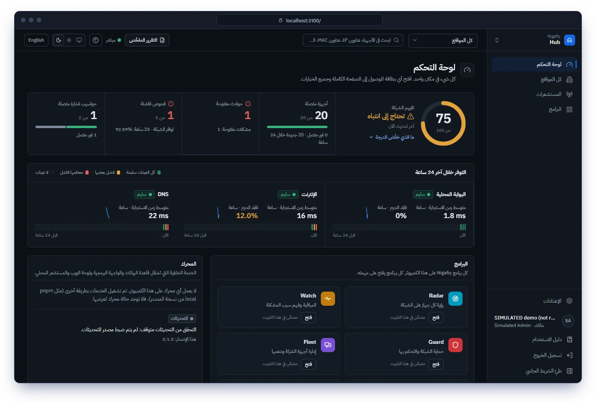
</p>

<table dir="rtl">
  <tr>
    <td width="33%" valign="top">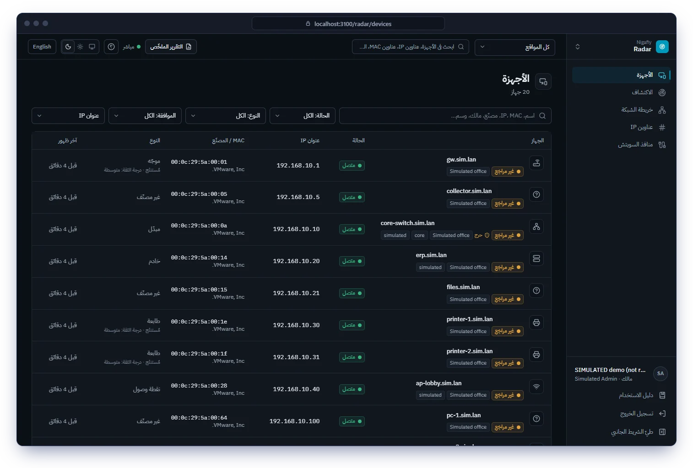<p align="center"><b>Radar</b><br><sub>كل جهاز، يُعرف بعنوان MAC حتى لو تغيّر عنوان IP</sub></p></td>
    <td width="33%" valign="top"><p align="center"><b>Watch</b><br><sub>حوادث بسببها الجذري والأدلة التي تدعمه</sub></p></td>
    <td width="33%" valign="top"><p align="center"><b>Fleet</b><br><sub>الحالة المباشرة والتحكم لكل حاسوب مُدار</sub></p></td>
  </tr>
</table>

<p align="center" dir="rtl"><sub>شاشات حقيقية من لوحة الويب، مملوءة ببيانات <a href="scripts/seed-simulated.mjs">الجهة التجريبية المُحاكاة</a> (أجهزة وقياسات مُختلَقة). نفس اللوحة بالإنجليزية وبالسمة الفاتحة: <a href="README.md#screenshots">README.md</a>.</sub></p>

<picture>
  <source media="(prefers-color-scheme: dark)" srcset="docs/assets/readme/divider-dark.svg">
  
</picture>

<a id="how-it-works"></a>
<h2 dir="rtl">طريقة العمل</h2>

<picture>
  <source media="(prefers-color-scheme: dark)" srcset="docs/assets/readme/how-it-works-ar-dark.svg">
  
</picture>

<a id="programs"></a>
<h2 dir="rtl">البرامج</h2>

<p align="center" dir="rtl"><a href="#program-hub"><picture><source media="(max-width: 600px)" srcset="docs/assets/readme/programs/hub-compact.svg"><source media="(prefers-color-scheme: dark)" srcset="docs/assets/readme/programs/hub-ar-dark.svg"></picture></a><a href="#program-radar"><picture><source media="(max-width: 600px)" srcset="docs/assets/readme/programs/radar-compact.svg"><source media="(prefers-color-scheme: dark)" srcset="docs/assets/readme/programs/radar-ar-dark.svg">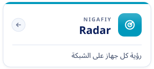</picture></a><a href="#program-watch"><picture><source media="(max-width: 600px)" srcset="docs/assets/readme/programs/watch-compact.svg"><source media="(prefers-color-scheme: dark)" srcset="docs/assets/readme/programs/watch-ar-dark.svg">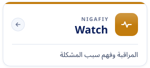</picture></a><br>
<a href="#program-guard"><picture><source media="(max-width: 600px)" srcset="docs/assets/readme/programs/guard-compact.svg"><source media="(prefers-color-scheme: dark)" srcset="docs/assets/readme/programs/guard-ar-dark.svg">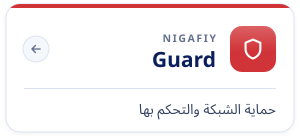</picture></a><a href="#program-fleet"><picture><source media="(max-width: 600px)" srcset="docs/assets/readme/programs/fleet-compact.svg"><source media="(prefers-color-scheme: dark)" srcset="docs/assets/readme/programs/fleet-ar-dark.svg">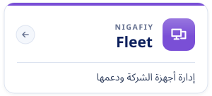</picture></a><a href="#program-mind"><picture><source media="(max-width: 600px)" srcset="docs/assets/readme/programs/mind-compact.svg"><source media="(prefers-color-scheme: dark)" srcset="docs/assets/readme/programs/mind-ar-dark.svg"></picture></a><br>
<a href="#program-toolbox"><picture><source media="(max-width: 600px)" srcset="docs/assets/readme/programs/toolbox-compact.svg"><source media="(prefers-color-scheme: dark)" srcset="docs/assets/readme/programs/toolbox-ar-dark.svg">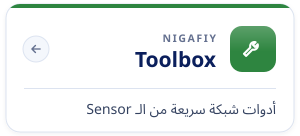</picture></a><a href="#program-sensor"><picture><source media="(max-width: 600px)" srcset="docs/assets/readme/programs/sensor-compact.svg"><source media="(prefers-color-scheme: dark)" srcset="docs/assets/readme/programs/sensor-ar-dark.svg">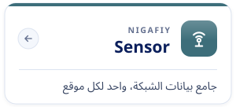</picture></a><a href="#program-agent"><picture><source media="(max-width: 600px)" srcset="docs/assets/readme/programs/agent-compact.svg"><source media="(prefers-color-scheme: dark)" srcset="docs/assets/readme/programs/agent-ar-dark.svg">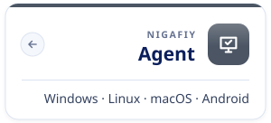</picture></a></p>

<p align="center" dir="rtl"><sub>سبعة برامج على محرك محلي واحد، ومعها الـ <b>Sensor</b> في كل موقع والـ <b>Agent</b> على كل جهاز مُدار.<br>اختر أي بطاقة لترى ما يفعله البرنامج.</sub></p>

<h3 dir="rtl">ماذا يفعل كل برنامج</h3>

<a id="program-hub"></a>
<details dir="rtl">
<summary> <b>Hub</b>: الرئيسية وتسجيل الدخول والإعدادات والمحرك</summary>
<br>

- تسجيل الدخول بكلمات مرور scrypt والتحقق الثنائي TOTP والدخول الموحد OIDC / SAML 2.0؛ الأدوار: مالك ومسؤول وفني ومشاهد؛ سجل التدقيق
- مبدّل البرامج والبحث الشامل والفحص الذاتي للنظام ودليل الاستخدام داخل التطبيق بالعربية والإنجليزية ولوحة العملاء لمزوّدي الخدمات
- المحرك `nigafiy-engine` يشرف على قاعدة البيانات والـ API ولوحة الويب والـ Sensor، ويعمل أيضاً كخدمة Windows
- تحديثات موقّعة بـ Ed25519، يُتحقق منها بـ SHA-256 وAuthenticode، ولا تُثبَّت إلا بعد تأكيد المسؤول
- مثبّتات NSIS وMSI وMSIX مع اختيار البرامج أثناء التثبيت؛ طريق مجاني لتوقيع الكود؛ نسخ احتياطي لقاعدة البيانات واستعادتها؛ تدوير مفتاح التشفير

التوثيق (بالإنجليزية): [المحرك](docs/desktop/engine.md) · [التحديثات](docs/operations/updates.md) · [المثبّتات](docs/operations/installers.md) · [توقيع الكود](docs/operations/code-signing.md) · [النسخ الاحتياطي والاستعادة](docs/operations/backup-restore-and-key-rotation.md)

</details>

<a id="program-radar"></a>
<details dir="rtl">
<summary> <b>Radar</b>: الاكتشاف والجرد</summary>
<br>

- مسح ICMP وجدول الجيران وmDNS وSSDP وNetBIOS وأسماء DHCP بالاستماع فقط
- هوية واحدة لكل جهاز بعنوان MAC حتى لو تغيّر عنوان IP؛ IPv4 وIPv6
- خريطة الشبكة بروابط مرصودة ومستنتجة (LLDP وCDP وMNDP) ونقاط الفشل المنفردة؛ إدارة عناوين IP؛ منافذ السويتش

التوثيق (بالإنجليزية): [IPv6](docs/features/ipv6.md) · [الأجهزة المجاورة](docs/features/neighbors-cdp-mndp.md)

</details>

<a id="program-watch"></a>
<details dir="rtl">
<summary> <b>Watch</b>: المراقبة والحوادث والإشعارات</summary>
<br>

- فحوص Ping وTCP وDNS وHTTP/HTTPS وانتهاء شهادات TLS وقيم SNMP
- أحداث بأدلتها؛ حوادث مترابطة تُغلق تلقائياً؛ طبيب الشبكة؛ آلة الزمن
- البريد وWebhooks موقّعة وTelegram وSlack وDiscord وntfy؛ سياسات التصعيد؛ نوافذ الصيانة

التوثيق (بالإنجليزية): [الفحوص](docs/features/watch-checks.md)

</details>

<a id="program-guard"></a>
<details dir="rtl">
<summary> <b>Guard</b>: التحكم والحماية</summary>
<br>

- التحكم في الوصول عبر DNS لأي راوتر: الفئات والمواقع والإيقاف المؤقت ومواعيد النوم، للشبكة كلها أو لملف أو لجهاز
- 16 تعريفاً للراوترات مع جدول بما يدعمه كل تعريف، وقراءة من الراوتر للتحقق بعد كل تغيير
- التحكم في منافذ السويتش عبر SNMP؛ فحوص أمنية (DHCP دخيل، UPnP، Wi-Fi، البصمات)
- نسخ الإعدادات احتياطياً عبر SSH ومقارنتها وإخفاء الأسرار منها؛ استعادة Junos وIOS XE وVyOS / EdgeOS وOpenWrt، ولكل منها مؤقت تراجع على الجهاز نفسه

التوثيق (بالإنجليزية): [التحكم في الراوترات](docs/features/router-controls.md) · [منافذ السويتش](docs/features/switch-port-control.md) · [الفحوص الأمنية](docs/features/smart-checks.md) · [نسخ الإعدادات](docs/features/config-backup.md)

</details>

<a id="program-fleet"></a>
<details dir="rtl">
<summary> <b>Fleet</b>: حواسيب الشركة وهواتفها</summary>
<br>

- سطح مكتب بعيد بموافقة المستخدم وشريط تنبيه ظاهر: WebRTC H.264 مباشرة على الشبكة المحلية لأجهزة Windows، وJPEG عبر WebSocket في غيرها وكبديل تلقائي
- مدير ملفات بلوحتين (قائمة انتظار واستئناف وSHA-256) وسطر الأوامر والسكربتات والمهام والتحديثات؛ تسجيل الجلسات
- سياسات وصول مع تحقق ثنائي وموافقة مسؤول ثانٍ؛ امتثال مبني على الأدلة المُقاسة فقط
- هواتف Android: التسجيل برمز QR والجرد والامتثال؛ وفي وضع Device Owner أيضاً القفل وسياسة كلمة المرور والكاميرا وتثبيت APK من Fleet والمسح الكامل

التوثيق (بالإنجليزية): [Fleet](docs/features/fleet-pro.md) · [الامتثال](docs/features/fleet-compliance.md) · [Android](docs/features/android.md)

<picture>
  <source media="(prefers-color-scheme: dark)" srcset="docs/assets/readme/fleet-remote-desktop-ar-dark.svg">
  
</picture>

</details>

<a id="program-mind"></a>
<details dir="rtl">
<summary> <b>Mind</b>: المعرفة وخطط العمل والأتمتة</summary>
<br>

- ذاكرة معرفة، وخطط عمل لا تُنفَّذ إلا بموافقة، وكتالوج أتمتة قابل للتخصيص
- بلا ذكاء اصطناعي: كل قاعدة ثابتة ومحددة

التوثيق (بالإنجليزية): [خطط العمل](docs/features/playbooks.md)

</details>

<a id="program-toolbox"></a>
<details dir="rtl">
<summary> <b>Toolbox</b>: أدوات شبكة سريعة</summary>
<br>

- Ping ومنفذ TCP والمنافذ الشائعة وDNS وDNS العكسي وتتبّع المسار، تُشغَّل من الـ Sensor في الموقع
- كل هدف يُفحص مقابل نطاقات الشبكة المسموحة؛ حاسبة الشبكات الفرعية

التوثيق (بالإنجليزية): [فحص النطاق](docs/features/toolbox-scope.md)

</details>

<a id="program-sensor"></a>
<details dir="rtl">
<summary> <b>Sensor</b>: واحد لكل موقع</summary>
<br>

- يعمل بالأمر `nigafiy-engine sensor`: الاكتشاف والفحوص وSNMP وتصفية DNS وتعريفات الراوترات ونسخ الإعدادات وأدوات Toolbox
- يتصل بالـ API للخارج عبر HTTPS ويحفظ البيانات على القرص عند الانقطاع؛ ومع شهادات LAN TLS المدمجة يثبّت بصمة شهادة الخادم

التوثيق (بالإنجليزية): [المحرك والـ Sensor](docs/architecture/engine-sensor.md) · [البروتوكول](docs/collector/protocol.md) · [LAN TLS](docs/features/lan-tls.md)

</details>

<a id="program-agent"></a>
<details dir="rtl">
<summary> <b>Agent</b>: واحد لكل جهاز مُدار</summary>
<br>

- Windows وLinux وmacOS (بلغة Go): خدمة Windows مع مساعد في جلسة المستخدم، ومثبّت NSIS بوضع صامت لـ GPO، وQuick Support (`nigafiy-support`) للمساعدة لمرة واحدة
- Android (بلغة Kotlin): ملف APK يُثبَّت يدوياً بلا Google Play وبلا Firebase، كتطبيق عادي أو في وضع Device Owner
- يتصل للخارج فقط، ولا ينفّذ إلا قائمة مغلقة من الإجراءات المحددة

التوثيق (بالإنجليزية): [المثبّتات](docs/operations/installers.md) · [Android](docs/features/android.md)

</details>

<p dir="rtl">كل الخصائص مجالاً مجالاً، مع روابط صفحاتها: <a href="docs/features/capabilities.md">docs/features/capabilities.md</a> (بالإنجليزية).</p>

<picture>
  <source media="(prefers-color-scheme: dark)" srcset="docs/assets/readme/divider-dark.svg">
  
</picture>

<a id="architecture"></a>
<h2 dir="rtl">البنية</h2>

<picture>
  <source media="(prefers-color-scheme: dark)" srcset="docs/assets/readme/architecture-ar-dark.svg">
  
</picture>

<div dir="rtl">

الخادم لا يفتح أي اتصال إلى داخل شبكة العميل: الـ Sensor والـ Agent هما من يتصلان بالخادم ويطلبان
الأوامر من قائمة مغلقة. باقي المخططات (المنافذ، الاكتشاف، التسجيل، سطح المكتب البعيد، تغييرات
الراوتر، استعادة الإعدادات، التحديثات، التوزيع، تسجيل الدخول) موجودة في
[docs/architecture/flowcharts.md](docs/architecture/flowcharts.md)، وشرح البنية مكتوباً في
[docs/architecture/overview.md](docs/architecture/overview.md) (بالإنجليزية).

</div>

<a id="quick-start"></a>
<h2 dir="rtl">البدء السريع</h2>

<div dir="rtl">

**المتطلبات:** Node.js 24 أو أحدث، وGo 1.27.4 أو أحدث (يثبّت `pnpm local` أداة pnpm 10 تلقائياً إن لم
تكن موجودة). لا حاجة إلى Docker أو PostgreSQL أو Redis.

</div>

```bash
pnpm local
```

<div dir="rtl">

على Windows يمكن بدلاً من ذلك النقر المزدوج على `Start Nigafiy.cmd`. التشغيل الأول يثبّت الاعتماديات،
وينشئ ملف `.env`، ويشغّل قاعدة البيانات والـ API وتطبيق الويب على هذا الجهاز، ويطلب تأكيد شبكتك،
وينشئ حسابك، ثم يفتح <bdi>http://localhost:3100</bdi>.

</div>

<details>
<summary dir="rtl"><b>التطوير: كل جزء في نافذة طرفية مستقلة</b></summary>

```bash
pnpm install
cp .env.example .env      # then set APP_ENCRYPTION_KEY and the lan_app password
pnpm dev:db               # PostgreSQL on 5433
pnpm dev:api              # API on 4100
pnpm dev:web              # web on 3100
```

</details>

<details>
<summary dir="rtl"><b>فحوص الجودة التي يمر بها كل تغيير</b></summary>

```bash
pnpm typecheck
pnpm lint
pnpm check:brand
pnpm test                 # API integration tests, real PostgreSQL + RLS
pnpm test:collector       # Sensor (Go)
pnpm test:agent           # Agent (Go)
pnpm test:engine          # Engine (Go)
pnpm build
pnpm test:web             # browser tests, English and Arabic
pnpm test:site            # website build and tests
```

<p dir="rtl">يشغّل CI الفحوص نفسها على Windows، ومعها مهام Go على Linux لكشف التسابق (race) والـ fuzzing وفحص الثغرات. ولوكيل Android فحوصه الخاصة: <code>pnpm test:android</code> (يحتاج أدوات بناء Android، راجع <a href="docs/features/android.md">android.md</a>).</p>

</details>

<details>
<summary dir="rtl"><b>خريطة المستودع</b></summary>

<div dir="rtl">

| المسار | ما هو |
| --- | --- |
| [`apps/api`](apps/api) | الـ API: Node 24 (TypeScript مباشرة) وExpress 5 وZod وPostgreSQL مع أمان على مستوى الصف، ومهام في الخلفية |
| [`apps/web`](apps/web) | لوحة الويب للبرامج السبعة: Next.js 16 وReact 19 وTailwind 4، بالعربية والإنجليزية |
| [`apps/desktop`](apps/desktop) | تطبيق سطح المكتب لـ Windows (Electron): نوافذ البرامج وأيقونة شريط المهام والوضع المحلي وحزم NSIS / MSI / MSIX |
| [`apps/site`](apps/site) | الموقع: تصدير ثابت بالعربية والإنجليزية، مبني ومختبَر لكنه غير منشور بعد |
| [`engine`](engine) | `nigafiy-engine` (Go): يشرف على قاعدة البيانات والـ API والويب والـ Sensor؛ خدمة Windows؛ واجهة تحكم؛ مساعد التحديث؛ مشغّلات البرامج |
| [`collectors/lan-collector`](collectors/lan-collector) | الـ Sensor (Go): الاكتشاف والفحوص وSNMP وتصفية DNS وتعريفات الراوترات ونسخ الإعدادات وToolbox |
| [`agents/endpoint-agent`](agents/endpoint-agent) | الـ Agent (Go) لـ Windows وLinux وmacOS، ومعه Quick Support (`nigafiy-support`) |
| [`agents/android-agent`](agents/android-agent) | وكيل Android (Kotlin، بواجهات النظام فقط) |
| [`packages/shared-types`](packages/shared-types) | أنواع عقد الـ API وقائمة البرامج وجدول المسارات المشترك بين الـ API والويب |
| [`packages/brand`](packages/brand) | الشعار وأيقونات البرامج وألوان الهوية |
| [`packaging`](packaging) | سكربت NSIS لمثبّت الـ Agent |
| [`scripts`](scripts) | `pnpm local` وفحص الاسم القديم واختبار e2e ورسومات README ولقطاته والمثبّتات والإصدار والتوقيع وبناء Android |
| [`docs`](docs) | البنية والخصائص والتشغيل والأمان وخطة العمل |
| [`.github`](.github) | سير عمل CI وقوالب البلاغات وطلبات الدمج |

</div>

</details>

<p dir="rtl">تفاصيل التثبيت وتشغيل الـ Sensor على جهاز آخر وبناء البرامج وكل أوامر الاختبار: <a href="docs/getting-started.md">docs/getting-started.md</a> (بالإنجليزية).</p>

<picture>
  <source media="(prefers-color-scheme: dark)" srcset="docs/assets/readme/divider-dark.svg">
  
</picture>

<a id="security"></a>
<h2 dir="rtl">الأمان</h2>

<picture>
  <source media="(prefers-color-scheme: dark)" srcset="docs/assets/readme/security-ar-dark.svg">
  
</picture>

<p dir="rtl">كل ضابط أمني ومكانه في الكود: <a href="docs/security/model.md">docs/security/model.md</a>. المراجعة الأمنية لشهر نوفمبر 2026 ونتائجها وإصلاحاتها: <a href="docs/security/review-2026-11.md">docs/security/review-2026-11.md</a> (كلاهما بالإنجليزية). للإبلاغ عن ثغرة: <a href="SECURITY.md">SECURITY.md</a>.</p>

<a id="documentation-and-status"></a>
<h2 dir="rtl">التوثيق والحالة</h2>

<div dir="rtl">

- 📚 **[فهرس التوثيق](docs/README.md)**: البنية والخصائص والتشغيل والأمان وخطة العمل
- 🧭 **[حالة المشروع](docs/roadmap/status.md)**: ما بُني، وما جُرّب على أجهزة حقيقية، وما اختُبر بالاختبارات فقط
- 🗺️ **[المخططات](docs/architecture/flowcharts.md)**: كل مسار موجود في الكود، مع روابطه
- 🌐 **[الموقع](docs/website.md)**: الموقع الثابت بالعربية والإنجليزية في `apps/site` (غير منشور بعد)
- 🤝 **[المساهمة](CONTRIBUTING.md)**: طريقة العمل الداخلية

<details>
<summary><b>الحالة بصراحة: ما جُرّب فعلاً وما اختُبر بالاختبارات فقط</b></summary>
<br>

جُرّب فعلاً على أجهزة المشروع: الاكتشاف والفحوص والفحوص الذكية على شبكة حقيقية؛ والوكيل على Windows مع
الـ API الحقيقي؛ والتحكم في راوتر واحد (Zyxel VMG3625-T50B) من الواجهة؛ وتثبيت حزم MSI وMSIX وفحصها
وإزالتها مع نجاح Windows App Certification Kit؛ والنسخ الاحتياطي لقاعدة البيانات واستعادتها بأدوات
PostgreSQL الحقيقية؛ ونجاح سير عمل CI على GitHub (فحص الأنواع والتنسيق والاختبارات والبناء).

ما لم يُجرَّب إلا أمام بدائل اختبار للبروتوكولات أو على عنوان loopback، وليس على أجهزة حقيقية: 15 من أصل
16 تعريفاً للراوترات، وسويتشات SNMP، والدخول الموحد SSO، واستعادة الإعدادات لكل الأنواع، والوكيل على
Linux وmacOS، وWebRTC بين جهازين (جُرّب في متصفح حقيقي على جهاز واحد فقط)، ووضع خدمة Windows للمحرك،
ومثبّت الوكيل، ووكيل Android على هاتف حقيقي (عمل على محاكي Android 16 كمالك للجهاز). الموقع مبني لكنه
غير منشور، والإصدار 1.0.4 إصدار داخلي غير منشور.
الملف [docs/roadmap/status.md](docs/roadmap/status.md) يذكر بالضبط ما جُرّب فعلاً وما لم يُجرَّب.

</details>

</div>

<a id="license"></a>
<h2 dir="rtl">الترخيص</h2>

<p dir="rtl">ترخيص خاص (مملوك): جميع الحقوق محفوظة. راجع <a href="LICENSE">LICENSE</a>. المكوّنات الخارجية تبقى بتراخيصها الخاصة.</p>
