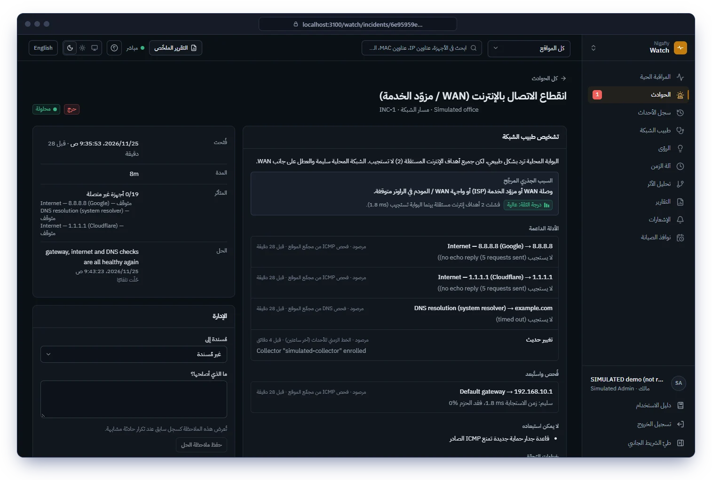
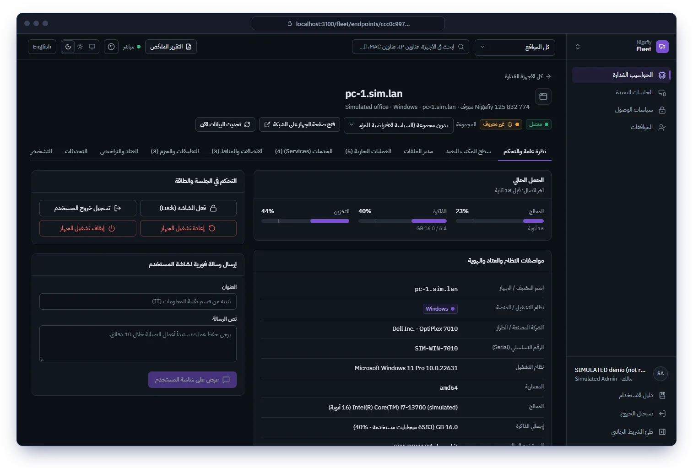

<p align="center">
  <picture>
    <source media="(prefers-color-scheme: dark)" srcset="docs/assets/readme/hero-ar-dark.svg">
    
  </picture>
</p>

<h3 align="center" dir="rtl">منصة مجانية لإدارة الشبكات وأجهزة الشركة، مبنية أولاً لنظام Windows.<br>على أجهزتك أنت، بالعربية والإنجليزية، بلا لوحة سحابية وبلا ذكاء اصطناعي.</h3>

<p align="center">
  <a href="https://github.com/MKhattab7050/nigafiy-platform/actions/workflows/ci.yml"></a>
  
  
  
  
</p>

<p align="center" dir="rtl">
  <a href="#quick-start"><b>البدء السريع</b></a> ·
  <a href="#screenshots"><b>لقطات الشاشة</b></a> ·
  <a href="#programs"><b>البرامج</b></a> ·
  <a href="#architecture"><b>البنية</b></a> ·
  <a href="docs/README.md"><b>التوثيق</b></a> ·
  <a href="#security"><b>الأمان</b></a> ·
  <a href="docs/roadmap/status.md"><b>الحالة</b></a> ·
  <a href="README.md"><b>English</b></a>
</p>

<br>

<div dir="rtl">

Nigafiy يكتشف كل جهاز على الشبكة ويراقبه، ويشرح الأعطال بقواعد ثابتة مبنية على أدلة مُقاسة، ويتحكم في
الراوترات والسويتشات وتصفية DNS، ويدير أجهزة الشركة (Windows وLinux وmacOS) ويدعمها عبر وكيل مُسجَّل
يوفر سطح المكتب البعيد والملفات وسطر الأوامر والتحديثات. سبعة برامج تعمل فوق محرك محلي واحد، والبيانات
تبقى على أجهزة الجهة نفسها.

</div>

<a id="screenshots"></a>

<p align="center">
  
</p>

<table dir="rtl">
  <tr>
    <td width="33%" valign="top"><p align="center"><b>Radar</b><br><sub>كل جهاز، يُعرف بعنوان MAC حتى لو تغيّر عنوان IP</sub></p></td>
    <td width="33%" valign="top"><p align="center"><b>Watch</b><br><sub>حوادث بسببها الجذري والأدلة التي تدعمه</sub></p></td>
    <td width="33%" valign="top"><p align="center"><b>Fleet</b><br><sub>الحالة المباشرة والتحكم لكل حاسوب مُدار</sub></p></td>
  </tr>
</table>

<p align="center" dir="rtl"><sub>شاشات حقيقية من لوحة الويب، مملوءة ببيانات <a href="scripts/seed-simulated.mjs">الجهة التجريبية المُحاكاة</a> (أجهزة وقياسات مُختلَقة). نفس اللوحة بالإنجليزية وبالسمة الفاتحة: <a href="README.md#screenshots">README.md</a>.</sub></p>

<picture>
  <source media="(prefers-color-scheme: dark)" srcset="docs/assets/readme/divider-dark.svg">
  
</picture>

<h2 dir="rtl">طريقة العمل</h2>

<picture>
  <source media="(prefers-color-scheme: dark)" srcset="docs/assets/readme/how-it-works-ar-dark.svg">
  
</picture>

<a id="programs"></a>
<h2 dir="rtl">البرامج</h2>

<table dir="rtl">
  <tr>
    <td align="center" valign="top" width="33%"><br><b>Nigafiy Hub</b><br><sub>الرئيسية وتسجيل الدخول والإعدادات والمحرك</sub></td>
    <td align="center" valign="top" width="33%"><br><b>Nigafiy Radar</b><br><sub>رؤية كل جهاز على الشبكة</sub></td>
    <td align="center" valign="top" width="33%"><br><b>Nigafiy Watch</b><br><sub>المراقبة وفهم سبب المشكلة</sub></td>
  </tr>
  <tr>
    <td align="center" valign="top" width="33%"><br><b>Nigafiy Guard</b><br><sub>حماية الشبكة والتحكم بها</sub></td>
    <td align="center" valign="top" width="33%"><br><b>Nigafiy Fleet</b><br><sub>إدارة أجهزة الشركة ودعمها</sub></td>
    <td align="center" valign="top" width="33%"><br><b>Nigafiy Mind</b><br><sub>المعرفة وخطط العمل والأتمتة</sub></td>
  </tr>
  <tr>
    <td align="center" valign="top" width="33%"><br><b>Nigafiy Toolbox</b><br><sub>أدوات شبكة سريعة</sub></td>
    <td align="center" valign="top" width="33%"><br><b>Nigafiy Sensor</b><br><sub>جامع بيانات الشبكة، واحد لكل موقع</sub></td>
    <td align="center" valign="top" width="33%"><br><b>Nigafiy Agent</b><br><sub>على كل جهاز مُدار</sub></td>
  </tr>
</table>

<p align="center" dir="rtl"><sub>يعمل الـ Sensor بالأمر <code>nigafiy-engine sensor</code>، ويعمل الـ Agent على Windows وLinux وmacOS.</sub></p>

<h3 dir="rtl">ماذا يفعل كل برنامج</h3>

<details dir="rtl">
<summary> <b>Radar</b>: الاكتشاف والجرد</summary>
<br>

- مسح ICMP وجدول الجيران وmDNS وSSDP وNetBIOS وأسماء DHCP بالاستماع فقط
- هوية واحدة لكل جهاز بعنوان MAC حتى لو تغيّر عنوان IP؛ IPv4 وIPv6
- خريطة الشبكة بروابط مرصودة ومستنتجة ونقاط الفشل المنفردة؛ إدارة عناوين IP؛ منافذ السويتش

</details>

<details dir="rtl">
<summary> <b>Watch</b>: المراقبة والحوادث والإشعارات</summary>
<br>

- فحوص Ping وTCP وDNS وHTTP/HTTPS وانتهاء شهادات TLS وقيم SNMP
- أحداث بأدلتها؛ حوادث مترابطة تُغلق تلقائياً؛ طبيب الشبكة؛ آلة الزمن
- البريد وWebhooks موقّعة وTelegram وSlack وDiscord وntfy؛ سياسات التصعيد؛ نوافذ الصيانة

</details>

<details dir="rtl">
<summary> <b>Guard</b>: التحكم والحماية</summary>
<br>

- التحكم في الوصول عبر DNS لأي راوتر
- 16 تعريفاً للراوترات، مع قراءة للتحقق بعد كل تغيير
- التحكم في منافذ السويتش عبر SNMP؛ فحوص أمنية؛ نسخ الإعدادات احتياطياً عبر SSH مع استعادة Junos وIOS XE

</details>

<details dir="rtl">
<summary> <b>Fleet</b>: أجهزة الشركة</summary>
<br>

- وكيل لأنظمة Windows وLinux وmacOS؛ امتثال مبني على الأدلة فقط
- سطح مكتب بعيد بموافقة المستخدم وشريط تنبيه ظاهر (JPEG عبر WebSocket، وWebRTC H.264 على Windows)
- الملفات وسطر الأوامر والسكربتات والمهام والتحديثات؛ سياسات وصول مع تحقق ثنائي وموافقة مسؤول ثانٍ

<picture>
  <source media="(prefers-color-scheme: dark)" srcset="docs/assets/readme/fleet-remote-desktop-ar-dark.svg">
  
</picture>

</details>

<details dir="rtl">
<summary> <b>Mind</b> و <b>Toolbox</b></summary>
<br>

- Mind: ذاكرة معرفة، وخطط عمل لا تُنفَّذ إلا بموافقة، وكتالوج أتمتة. بلا ذكاء اصطناعي
- Toolbox: Ping ومنفذ TCP والمنافذ الشائعة وDNS وDNS العكسي وتتبّع المسار من الـ Sensor، وحاسبة الشبكات الفرعية

</details>

<p dir="rtl">كل الخصائص مجال بمجال، مع روابط صفحاتها: <a href="docs/features/capabilities.md">docs/features/capabilities.md</a> (بالإنجليزية).</p>

<picture>
  <source media="(prefers-color-scheme: dark)" srcset="docs/assets/readme/divider-dark.svg">
  
</picture>

<a id="architecture"></a>
<h2 dir="rtl">البنية</h2>

<picture>
  <source media="(prefers-color-scheme: dark)" srcset="docs/assets/readme/architecture-ar-dark.svg">
  
</picture>

<div dir="rtl">

الخادم لا يفتح أي اتصال إلى داخل شبكة العميل: الـ Sensor والـ Agent هما من يتصلان بالخادم ويطلبان
الأوامر من قائمة مغلقة. باقي المخططات (المنافذ، الاكتشاف، التسجيل، سطح المكتب البعيد، تغييرات
الراوتر، استعادة الإعدادات، التحديثات، التوزيع، تسجيل الدخول) موجودة في
[docs/architecture/flowcharts.md](docs/architecture/flowcharts.md) (بالإنجليزية).

</div>

<a id="quick-start"></a>
<h2 dir="rtl">البدء السريع</h2>

<div dir="rtl">

**المتطلبات:** Node.js 24 أو أحدث، وGo 1.27.3 أو أحدث (يثبّت `pnpm local` أداة pnpm 10 تلقائياً إن لم
تكن موجودة). لا حاجة إلى Docker أو PostgreSQL أو Redis.

</div>

```bash
pnpm local
```

<div dir="rtl">

على Windows يمكن بدلاً من ذلك النقر المزدوج على `Start Nigafiy.cmd`. التشغيل الأول يثبّت الاعتماديات،
وينشئ ملف `.env`، ويشغّل قاعدة البيانات والـ API وتطبيق الويب على هذا الجهاز، ويطلب تأكيد شبكتك،
وينشئ حسابك، ثم يفتح http://localhost:3100.

</div>

<details>
<summary dir="rtl"><b>فحوص الجودة التي يمر بها كل تغيير</b></summary>

```bash
pnpm typecheck
pnpm lint
pnpm check:brand
pnpm test
pnpm test:collector
pnpm test:agent
pnpm test:engine
pnpm build
```

</details>

<p dir="rtl">تفاصيل التثبيت وبناء البرامج وكل أوامر الاختبار: <a href="docs/getting-started.md">docs/getting-started.md</a> (بالإنجليزية).</p>

<picture>
  <source media="(prefers-color-scheme: dark)" srcset="docs/assets/readme/divider-dark.svg">
  
</picture>

<a id="security"></a>
<h2 dir="rtl">الأمان</h2>

<picture>
  <source media="(prefers-color-scheme: dark)" srcset="docs/assets/readme/security-ar-dark.svg">
  
</picture>

<p dir="rtl">كل ضابط أمني ومكانه في الكود: <a href="docs/security/model.md">docs/security/model.md</a> (بالإنجليزية). للإبلاغ عن ثغرة: <a href="SECURITY.md">SECURITY.md</a>.</p>

<div dir="rtl">

## التوثيق والحالة

- 📚 **[فهرس التوثيق](docs/README.md)**: البنية والخصائص والتشغيل والأمان وخطة العمل
- 🧭 **[حالة المشروع](docs/roadmap/status.md)**: ما بُني، وما جُرّب على أجهزة حقيقية، وما اختُبر بالاختبارات فقط
- 🗺️ **[المخططات](docs/architecture/flowcharts.md)**: كل مسار موجود في الكود، مع روابطه

<details>
<summary><b>الحالة بصراحة: ما جُرّب فعلاً وما اختُبر بالاختبارات فقط</b></summary>
<br>

كثير من الخصائص لم تُجرَّب إلا أمام بدائل اختبار للبروتوكولات أو على عنوان loopback، وليس على أجهزة
حقيقية؛ مثل 15 من أصل 16 مشغّل راوتر (ومنها تحكم Cisco IOS XE)، وسويتشات SNMP، وتسجيل الدخول الموحد
SSO، واستعادة الإعدادات (Junos وIOS XE)، والوكيل على Linux وmacOS، وWebRTC في متصفح حقيقي، ووضع خدمة
Windows للمحرك، ومثبّتات MSI والوكيل. أما الاكتشاف والفحوص فعملت على شبكة حقيقية، والوكيل على Windows
عمل مع الـ API الحقيقي، وتم التحكم فعلياً في راوتر واحد (Zyxel VMG3625-T50B). ولم يعمل سير عمل CI على
GitHub بعد. الملف [docs/roadmap/status.md](docs/roadmap/status.md) يذكر بالضبط ما جُرّب فعلاً وما لم
يُجرَّب.

</details>

## الترخيص

لم يُحدَّد بعد: جميع الحقوق محفوظة حتى ذلك الحين.

</div>
