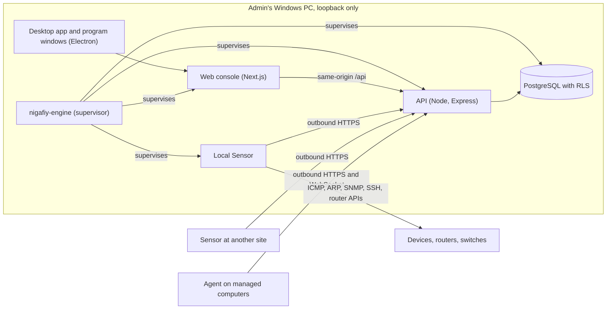

<div dir="rtl">

# Nigafiy

</div>

<!-- شارة CI: رابط نسبي داخل المستودع، يعمل بعد رفع المستودع إلى GitHub وتشغيل سير العمل؛ لم يُختبر قبل أول رفع. -->
[](../../actions/workflows/ci.yml)

<div dir="rtl">

[English](README.md) | **العربية**

Nigafiy منصة مجانية لإدارة الشبكات وأجهزة الشركة، مبنية أولاً لنظام Windows، لمسؤولي تقنية المعلومات
ومزوّدي الخدمات المُدارة (MSP). سبعة برامج تعمل فوق محرك محلي واحد: تكتشف كل جهاز على الشبكة وتراقبه،
وتشرح الأعطال بقواعد ثابتة مبنية على أدلة مُقاسة، وتتحكم في الراوترات والسويتشات وتصفية DNS، وتدير
أجهزة الشركة (Windows وLinux وmacOS) وتدعمها عبر وكيل مُسجَّل يوفر سطح المكتب البعيد والملفات وسطر
الأوامر والتحديثات. البيانات تبقى على أجهزة الجهة نفسها؛ لا يوجد ذكاء اصطناعي في أي مكان، ولا لوحة تحكم
سحابية. الواجهة بالعربية والإنجليزية (اتجاه من اليمين لليسار كامل)، بسمة فاتحة وداكنة.

## البرامج

| البرنامج | المهمة |
| --- | --- |
| **Nigafiy Hub** | الرئيسية وتسجيل الدخول والإعدادات والمحرك |
| **Nigafiy Radar** | رؤية كل جهاز على الشبكة |
| **Nigafiy Watch** | المراقبة وفهم سبب المشكلة |
| **Nigafiy Guard** | حماية الشبكة والتحكم بها |
| **Nigafiy Fleet** | إدارة أجهزة الشركة ودعمها |
| **Nigafiy Mind** | المعرفة وخطط العمل والأتمتة |
| **Nigafiy Toolbox** | أدوات شبكة سريعة |

ويعمل مكوّنان آخران على أجهزة أخرى: **Nigafiy Sensor** (جامع بيانات الشبكة، واحد لكل موقع، ويشغّل
Hub واحداً محلياً) و**Nigafiy Agent** (على كل جهاز مُدار).

## البنية

</div>



<div dir="rtl">

الخادم لا يفتح أي اتصال إلى داخل شبكة العميل: الـ Sensor والـ Agent هما من يتصلان بالخادم ويطلبان
الأوامر من قائمة مغلقة. باقي المخططات (المنافذ، الاكتشاف، التسجيل، سطح المكتب البعيد، تغييرات
الراوتر، استعادة الإعدادات، التحديثات، التوزيع، تسجيل الدخول) موجودة في
[docs/architecture/flowcharts.md](docs/architecture/flowcharts.md) (بالإنجليزية).

## البدء السريع

**المتطلبات:** Node.js 24 أو أحدث، وGo 1.27.3 أو أحدث (يثبّت `pnpm local` أداة pnpm 10 تلقائياً إن لم
تكن موجودة). لا حاجة إلى Docker أو PostgreSQL أو Redis.

</div>

```bash
pnpm local
```

<div dir="rtl">

على Windows يمكن بدلاً من ذلك النقر المزدوج على `Start Nigafiy.cmd`. التشغيل الأول يثبّت الاعتماديات،
وينشئ ملف `.env`، ويشغّل قاعدة البيانات والـ API وتطبيق الويب على هذا الجهاز، ويطلب تأكيد شبكتك،
وينشئ حسابك، ثم يفتح http://localhost:3100.

فحوص الجودة التي يمر بها كل تغيير:

</div>

```bash
pnpm typecheck
pnpm lint
pnpm check:brand
pnpm test
pnpm test:collector
pnpm test:agent
pnpm test:engine
pnpm build
```

<div dir="rtl">

تفاصيل التثبيت وبناء البرامج وكل أوامر الاختبار: [docs/getting-started.md](docs/getting-started.md)
(بالإنجليزية).

## التوثيق والحالة

- [فهرس التوثيق](docs/README.md)
- [حالة المشروع: ما بُني، وما جُرّب على أجهزة حقيقية، وما اختُبر بالاختبارات فقط](docs/roadmap/status.md)
- [نموذج الأمان](docs/security/model.md) و[طريقة الإبلاغ عن ثغرة](SECURITY.md)

**الحالة بصراحة:** كثير من الخصائص لم تُجرَّب إلا أمام بدائل اختبار للبروتوكولات أو على عنوان
loopback، وليس على أجهزة حقيقية؛ مثل 15 من أصل 16 مشغّل راوتر، وسويتشات SNMP، وتسجيل الدخول الموحد
SSO، واستعادة الإعدادات، والوكيل على Linux وmacOS، ووضع خدمة Windows للمحرك، ومثبّتات MSI والوكيل. ولم
يعمل سير عمل CI على GitHub بعد. الملف [docs/roadmap/status.md](docs/roadmap/status.md) يذكر بالضبط ما
جُرّب فعلاً وما لم يُجرَّب.

## الترخيص

لم يُحدَّد بعد: جميع الحقوق محفوظة حتى ذلك الحين.

</div>
