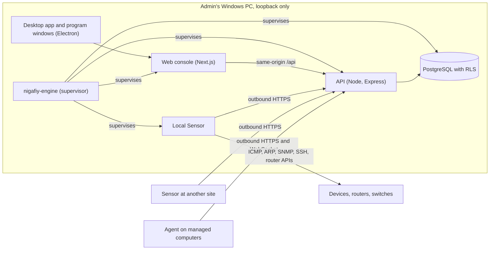

<p align="center">
  <picture>
    <source media="(prefers-color-scheme: dark)" srcset="docs/assets/readme/hero-dark.svg">
    
  </picture>
</p>

<p align="center">
  <a href="https://github.com/MKhattab7050/nigafiy-platform/actions/workflows/ci.yml"></a>
  
  
  
  
  
  
  
</p>

<p align="center"><b>English</b> · <a href="README.ar.md">العربية</a></p>

Nigafiy is a free, Windows-first network and endpoint management platform for IT administrators and
MSPs. Seven programs share one local engine: it finds and monitors every device on the network,
explains incidents with deterministic, evidence-backed rules, controls routers, switches and DNS
access, and manages and supports company computers (Windows, Linux, macOS) through an enrolled agent
with remote desktop, files, shell and patching. Data stays on the organization's own machines; there is
no AI anywhere and no cloud control panel. The interface is in English and Arabic (full RTL), in light
and dark themes.

<picture>
  <source media="(prefers-color-scheme: dark)" srcset="docs/assets/readme/how-it-works-dark.svg">
  
</picture>

<picture>
  <source media="(prefers-color-scheme: dark)" srcset="docs/assets/readme/divider-dark.svg">
  
</picture>

## Programs

<table>
  <tr>
    <td align="center" valign="top" width="33%"><br><b>Nigafiy Hub</b><br><sub>Home, sign-in, settings and the engine</sub></td>
    <td align="center" valign="top" width="33%"><br><b>Nigafiy Radar</b><br><sub>See every device on the network</sub></td>
    <td align="center" valign="top" width="33%"><br><b>Nigafiy Watch</b><br><sub>Monitor, and understand what went wrong</sub></td>
  </tr>
  <tr>
    <td align="center" valign="top" width="33%"><br><b>Nigafiy Guard</b><br><sub>Protect and control the network</sub></td>
    <td align="center" valign="top" width="33%"><br><b>Nigafiy Fleet</b><br><sub>Manage and support company computers</sub></td>
    <td align="center" valign="top" width="33%"><br><b>Nigafiy Mind</b><br><sub>Knowledge, playbooks and automation</sub></td>
  </tr>
  <tr>
    <td align="center" valign="top" width="33%"><br><b>Nigafiy Toolbox</b><br><sub>Quick network tools</sub></td>
    <td align="center" valign="top" width="33%"><br><b>Nigafiy Sensor</b><br><sub>Network collector, one per site</sub></td>
    <td align="center" valign="top" width="33%"><br><b>Nigafiy Agent</b><br><sub>On every managed computer</sub></td>
  </tr>
</table>

The Sensor runs as `nigafiy-engine sensor`; the Agent runs on Windows, Linux and macOS.

The program list is defined once in [`packages/shared-types/src/programs.ts`](packages/shared-types/src/programs.ts);
icons and accents come from [`packages/brand`](packages/brand).

## What it does

| | Area | Highlights |
| :---: | --- | --- |
| 🔎 | **Discovery and inventory** (Radar) | ICMP sweep, neighbour table, mDNS, SSDP, NetBIOS, passive DHCP names; identity by MAC across IP changes; IPv4 and IPv6; topology with observed and inferred links; IPAM |
| 📈 | **Monitoring and incidents** (Watch) | Ping, TCP, DNS, HTTP/HTTPS, TLS expiry and SNMP OID checks; events with evidence; incidents correlated and auto-resolved; Network Doctor; Time Machine |
| 🔔 | **Notifications** (Watch) | Email, signed webhooks, Telegram, Slack, Discord, ntfy; escalation policies; maintenance windows |
| 🛡️ | **Control** (Guard) | DNS access control for any router; 16 router drivers with read-back after every change; switch port control over SNMP; security checks; SSH config backup with Junos and IOS XE restore |
| 💻 | **Computers** (Fleet) | Agent for Windows, Linux, macOS; evidence-only compliance; remote desktop with consent and banner (WebSocket JPEG, WebRTC H.264 on Windows); files, shell, scripts, jobs, patches |
| 🧠 | **Knowledge and automation** (Mind) | Knowledge memory, approval-gated playbooks, automation catalogue. No AI |
| 🧰 | **Tools** (Toolbox) | Ping, TCP port, common ports, DNS, reverse DNS, traceroute from the site Sensor, subnet calculator |
| 🔐 | **Security** | PostgreSQL Row Level Security per tenant, roles, TOTP MFA, OIDC and SAML SSO, AES-256-GCM sealed secrets, append-only audit log |

Area by area, with links to every feature page: [docs/features/capabilities.md](docs/features/capabilities.md).

<picture>
  <source media="(prefers-color-scheme: dark)" srcset="docs/assets/readme/divider-dark.svg">
  
</picture>

## Architecture



The server never opens a connection into a customer network: Sensors and Agents dial out and poll for
commands from a closed list. More diagrams (ports, discovery, enrollment, remote desktop, router
changes, config restore, updates, distribution, sign-in) are in
[docs/architecture/flowcharts.md](docs/architecture/flowcharts.md); the written architecture is in
[docs/architecture/overview.md](docs/architecture/overview.md).

<picture>
  <source media="(prefers-color-scheme: dark)" srcset="docs/assets/readme/divider-dark.svg">
  
</picture>

## Quick start

**Prerequisites:** Node.js 24+, Go 1.27.3+ (pnpm 10 is installed for you by `pnpm local` when missing).
No Docker, PostgreSQL or Redis needed.

```bash
pnpm local
```

On Windows you can double-click `Start Nigafiy.cmd` instead. The first run installs dependencies,
creates `.env`, starts the database, API and web app on this computer, asks you to confirm your
network, creates your account and opens http://localhost:3100.

<details>
<summary><b>Development: run each part in its own terminal</b></summary>

```bash
pnpm install
cp .env.example .env      # then set APP_ENCRYPTION_KEY and the lan_app password
pnpm dev:db               # PostgreSQL on 5433
pnpm dev:api              # API on 4100
pnpm dev:web              # web on 3100
```

</details>

<details>
<summary><b>The gate every change passes</b></summary>

```bash
pnpm typecheck
pnpm lint
pnpm check:brand
pnpm test                 # API integration tests, real PostgreSQL + RLS
pnpm test:collector       # Sensor (Go)
pnpm test:agent           # Agent (Go)
pnpm test:engine          # Engine (Go)
pnpm build
```

</details>

The desktop installer, the Sensor on another machine, every build target and every test command:
[docs/getting-started.md](docs/getting-started.md).

<details>
<summary><b>Repository map</b></summary>

| Path | What it is |
| --- | --- |
| [`apps/api`](apps/api) | API: Node 24 (native TypeScript), Express 5, Zod, PostgreSQL with Row Level Security, background jobs |
| [`apps/web`](apps/web) | Web console for all seven programs: Next.js 16, React 19, Tailwind 4, EN + AR |
| [`apps/desktop`](apps/desktop) | Windows desktop app (Electron): program windows, tray, local mode, NSIS / MSI / MSIX packaging |
| [`engine`](engine) | `nigafiy-engine` (Go): supervises database, API, web and Sensor; Windows service; control API; update helper; program launchers |
| [`collectors/lan-collector`](collectors/lan-collector) | The Sensor (Go): discovery, checks, SNMP, DNS filter, router drivers, config backup, Toolbox |
| [`agents/endpoint-agent`](agents/endpoint-agent) | The Agent (Go) for Windows, Linux and macOS, plus Quick Support (`nigafiy-support`) |
| [`packages/shared-types`](packages/shared-types) | API contract types, program list and route table shared by API and web |
| [`packages/brand`](packages/brand) | Logo, program icons and colour tokens |
| [`packaging`](packaging) | Endpoint agent NSIS script |
| [`scripts`](scripts) | `pnpm local`, brand check, e2e smoke, installers, release and signing scripts |
| [`docs`](docs) | Architecture, features, operations, security, roadmap |
| [`.github`](.github) | CI workflow, issue and pull request templates |

</details>

<picture>
  <source media="(prefers-color-scheme: dark)" srcset="docs/assets/readme/divider-dark.svg">
  
</picture>

## Documentation and status

- 📚 [Documentation index](docs/README.md)
- 🧭 [Project status: what is built, what ran on real hardware, what is tested only](docs/roadmap/status.md)
- 🔐 [Security model](docs/security/model.md) and [how to report a vulnerability](SECURITY.md)
- 🤝 [Contributing (internal workflow)](CONTRIBUTING.md)

<details>
<summary><b>Honest status: tested for real versus tests only</b></summary>

Many features have only been exercised against protocol test doubles, fixtures or loopback, not on real
hardware: for example 15 of the 16 router drivers (Cisco IOS XE controls included), SNMP switches, SSO,
config restore (Junos and IOS XE), the agent on Linux and macOS, WebRTC in a real browser, the engine's
Windows service mode and the MSI / agent installers. Discovery, checks and smart checks ran on a real
LAN; the Windows agent ran against the real API; one router (Zyxel VMG3625-T50B) was controlled for
real. The GitHub CI workflow has not run yet. [docs/roadmap/status.md](docs/roadmap/status.md) lists
exactly what ran for real and what did not.

</details>

## License

Not yet chosen: all rights reserved until then.
