<p align="center">
  <picture>
    <source media="(prefers-color-scheme: dark)" srcset="docs/assets/readme/hero-dark.svg">
    
  </picture>
</p>

<h3 align="center">Windows-first network and endpoint management for IT teams and MSPs.<br>On your own machines, in English and Arabic, with no cloud panel and no AI.</h3>

<p align="center">
  <a href="https://github.com/MKhattab7050/nigafiy-platform/actions/workflows/ci.yml"></a>
  
  
  
  
  <a href="LICENSE"></a>
</p>

<p align="center">
  <a href="#screenshots"><b>Screenshots</b></a> ·
  <a href="#programs"><b>Programs</b></a> ·
  <a href="#architecture"><b>Architecture</b></a> ·
  <a href="#quick-start"><b>Quick start</b></a> ·
  <a href="#security"><b>Security</b></a> ·
  <a href="#documentation-and-status"><b>Docs and status</b></a> ·
  <a href="README.ar.md"><b>العربية</b></a>
</p>

<br>

Nigafiy finds and monitors every device on the network, explains incidents with deterministic,
evidence-backed rules, controls routers, switches and DNS access, and manages and supports company
computers (Windows, Linux, macOS) and Android phones through enrolled agents, with remote desktop,
files, shell and patching. Seven programs share one local engine, and the data stays on the
organization's own machines.

<a id="screenshots"></a>

<p align="center">
  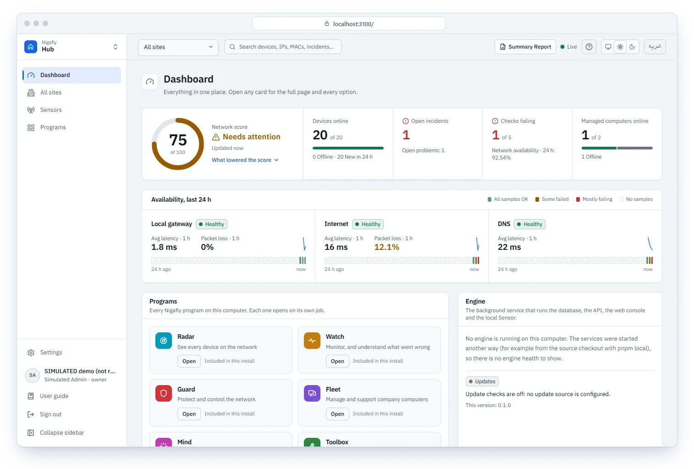
</p>

<table>
  <tr>
    <td width="33%" valign="top"><p align="center"><b>Radar</b><br><sub>every device, identified by MAC across IP changes</sub></p></td>
    <td width="33%" valign="top">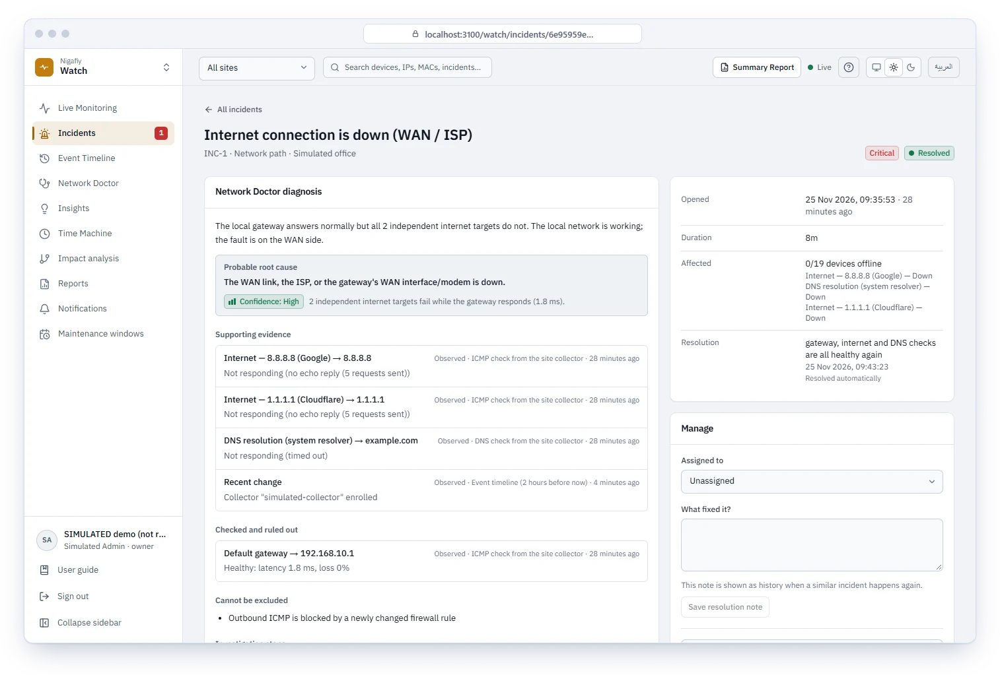<p align="center"><b>Watch</b><br><sub>incidents with a root cause and the evidence behind it</sub></p></td>
    <td width="33%" valign="top">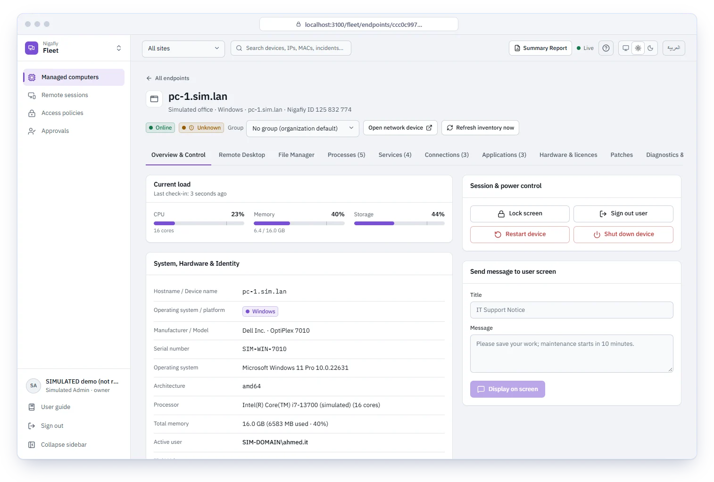<p align="center"><b>Fleet</b><br><sub>live state and controls for every managed computer</sub></p></td>
  </tr>
</table>

<p align="center"><sub>Real screens of the web console, filled with the <a href="scripts/seed-simulated.mjs">simulated demo organization</a> (invented devices and telemetry). The same console in Arabic, right to left, in the dark theme: <a href="README.ar.md#screenshots">README.ar.md</a>.</sub></p>

<picture>
  <source media="(prefers-color-scheme: dark)" srcset="docs/assets/readme/divider-dark.svg">
  
</picture>

## How it works

<picture>
  <source media="(prefers-color-scheme: dark)" srcset="docs/assets/readme/how-it-works-dark.svg">
  
</picture>

## Programs

<p align="center"><a href="#program-hub"><picture><source media="(max-width: 600px)" srcset="docs/assets/readme/programs/hub-compact.svg"><source media="(prefers-color-scheme: dark)" srcset="docs/assets/readme/programs/hub-dark.svg">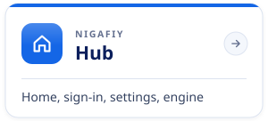</picture></a><a href="#program-radar"><picture><source media="(max-width: 600px)" srcset="docs/assets/readme/programs/radar-compact.svg"><source media="(prefers-color-scheme: dark)" srcset="docs/assets/readme/programs/radar-dark.svg">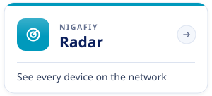</picture></a><a href="#program-watch"><picture><source media="(max-width: 600px)" srcset="docs/assets/readme/programs/watch-compact.svg"><source media="(prefers-color-scheme: dark)" srcset="docs/assets/readme/programs/watch-dark.svg">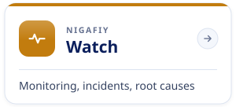</picture></a><br>
<a href="#program-guard"><picture><source media="(max-width: 600px)" srcset="docs/assets/readme/programs/guard-compact.svg"><source media="(prefers-color-scheme: dark)" srcset="docs/assets/readme/programs/guard-dark.svg">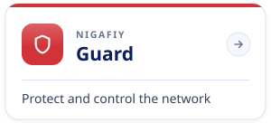</picture></a><a href="#program-fleet"><picture><source media="(max-width: 600px)" srcset="docs/assets/readme/programs/fleet-compact.svg"><source media="(prefers-color-scheme: dark)" srcset="docs/assets/readme/programs/fleet-dark.svg">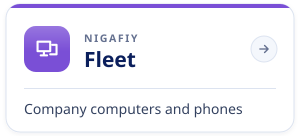</picture></a><a href="#program-mind"><picture><source media="(max-width: 600px)" srcset="docs/assets/readme/programs/mind-compact.svg"><source media="(prefers-color-scheme: dark)" srcset="docs/assets/readme/programs/mind-dark.svg">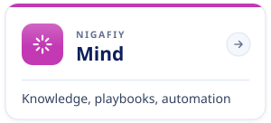</picture></a><br>
<a href="#program-toolbox"><picture><source media="(max-width: 600px)" srcset="docs/assets/readme/programs/toolbox-compact.svg"><source media="(prefers-color-scheme: dark)" srcset="docs/assets/readme/programs/toolbox-dark.svg">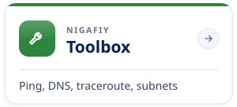</picture></a><a href="#program-sensor"><picture><source media="(max-width: 600px)" srcset="docs/assets/readme/programs/sensor-compact.svg"><source media="(prefers-color-scheme: dark)" srcset="docs/assets/readme/programs/sensor-dark.svg">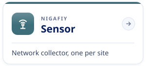</picture></a><a href="#program-agent"><picture><source media="(max-width: 600px)" srcset="docs/assets/readme/programs/agent-compact.svg"><source media="(prefers-color-scheme: dark)" srcset="docs/assets/readme/programs/agent-dark.svg">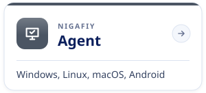</picture></a></p>

<p align="center"><sub>Seven programs on one local engine, plus the <b>Sensor</b> at each site and the <b>Agent</b> on each managed device.<br>Select a card for what it does.</sub></p>

### What each program does

<a id="program-hub"></a>
<details>
<summary> <b>Hub</b>: home, sign-in, settings and the engine</summary>
<br>

- Sign-in with scrypt passwords, TOTP MFA and OIDC / SAML 2.0 single sign-on; roles owner, admin, technician, viewer; audit log
- Program switcher, global search, system self-check, in-app user guide in English and Arabic, MSP portfolio
- `nigafiy-engine` supervises the database, API, web console and Sensor, also as a Windows service
- Ed25519-signed updates, checked by SHA-256 and Authenticode and installed only on an admin's confirmation
- NSIS, MSI and MSIX installers with a program choice at install; free code-signing route; database backup and restore; key rotation

Docs: [engine](docs/desktop/engine.md) · [updates](docs/operations/updates.md) · [installers](docs/operations/installers.md) · [code signing](docs/operations/code-signing.md) · [backup and restore](docs/operations/backup-restore-and-key-rotation.md)

</details>

<a id="program-radar"></a>
<details>
<summary> <b>Radar</b>: discovery and inventory</summary>
<br>

- ICMP sweep, neighbour table, mDNS, SSDP, NetBIOS and passive DHCP names
- One identity per device by MAC, across IP changes; IPv4 and IPv6
- Topology with observed and inferred links (LLDP, CDP, MNDP), single points of failure; IPAM; switch ports

Docs: [IPv6](docs/features/ipv6.md) · [neighbours](docs/features/neighbors-cdp-mndp.md)

</details>

<a id="program-watch"></a>
<details>
<summary> <b>Watch</b>: monitoring, incidents and notifications</summary>
<br>

- Ping, TCP, DNS, HTTP/HTTPS, TLS expiry and SNMP OID checks
- Events with evidence; incidents correlated and resolved automatically; Network Doctor; Time Machine
- Email, signed webhooks, Telegram, Slack, Discord and ntfy; escalation policies; maintenance windows

Docs: [checks](docs/features/watch-checks.md)

</details>

<a id="program-guard"></a>
<details>
<summary> <b>Guard</b>: control and protection</summary>
<br>

- DNS access control for any router: categories, sites, pauses and bedtimes per network, profile or device
- 16 router drivers with a per-driver controls matrix, each change read back from the router
- Switch port control over SNMP; security checks (rogue DHCP, UPnP, Wi-Fi, fingerprinting)
- SSH config backup, diff and secret sanitization; restore for Junos, IOS XE, VyOS / EdgeOS and OpenWrt, each with a rollback timer on the device

Docs: [router controls](docs/features/router-controls.md) · [switch ports](docs/features/switch-port-control.md) · [security checks](docs/features/smart-checks.md) · [config backup](docs/features/config-backup.md)

</details>

<a id="program-fleet"></a>
<details>
<summary> <b>Fleet</b>: company computers and phones</summary>
<br>

- Remote desktop with consent and an on-screen banner: WebRTC H.264 directly on the LAN for Windows agents, WebSocket JPEG everywhere else and as the automatic fallback
- Two-pane file manager (queue, resume, SHA-256), shell, scripts, jobs and patches; recordings
- Access policies with MFA step-up and second-admin approval; compliance from measured evidence only
- Android phones: enrollment by QR, inventory and compliance; as Device Owner also lock, password policy, camera, APK install from Fleet and wipe

Docs: [Fleet](docs/features/fleet-pro.md) · [compliance](docs/features/fleet-compliance.md) · [Android](docs/features/android.md)

<picture>
  <source media="(prefers-color-scheme: dark)" srcset="docs/assets/readme/fleet-remote-desktop-dark.svg">
  
</picture>

</details>

<a id="program-mind"></a>
<details>
<summary> <b>Mind</b>: knowledge, playbooks and automation</summary>
<br>

- Knowledge memory, approval-gated playbooks and an automation catalogue with overrides
- No AI: every rule is deterministic

Docs: [playbooks](docs/features/playbooks.md)

</details>

<a id="program-toolbox"></a>
<details>
<summary> <b>Toolbox</b>: quick network tools</summary>
<br>

- Ping, TCP port, common ports, DNS, reverse DNS and traceroute, run from the site's Sensor
- Every target checked against the authorized network scopes; subnet calculator

Docs: [scope checks](docs/features/toolbox-scope.md)

</details>

<a id="program-sensor"></a>
<details>
<summary> <b>Sensor</b>: one per site</summary>
<br>

- Runs as `nigafiy-engine sensor`: discovery, checks, SNMP, the DNS filter, router drivers, config backup and Toolbox probes
- Dials out to the API over HTTPS and buffers on disk; with the built-in LAN TLS it pins the server's certificate

Docs: [engine and Sensor](docs/architecture/engine-sensor.md) · [protocol](docs/collector/protocol.md) · [LAN TLS](docs/features/lan-tls.md)

</details>

<a id="program-agent"></a>
<details>
<summary> <b>Agent</b>: one per managed device</summary>
<br>

- Windows, Linux and macOS (Go): a Windows service with a user-session helper, an NSIS installer with a silent GPO mode, and Quick Support (`nigafiy-support`) for one-off help
- Android (Kotlin): a sideloaded APK with no Google Play or Firebase, as a regular app or as Device Owner
- Only dials out, and runs only a closed list of typed actions

Docs: [installers](docs/operations/installers.md) · [Android](docs/features/android.md)

</details>

Area by area, with links to every feature page: [docs/features/capabilities.md](docs/features/capabilities.md).

<picture>
  <source media="(prefers-color-scheme: dark)" srcset="docs/assets/readme/divider-dark.svg">
  
</picture>

## Architecture

<picture>
  <source media="(prefers-color-scheme: dark)" srcset="docs/assets/readme/architecture-dark.svg">
  
</picture>

The server never opens a connection into a customer network: Sensors and Agents dial out and poll for
commands from a closed list. More diagrams (ports, discovery, enrollment, remote desktop, router
changes, config restore, updates, distribution, sign-in) are in
[docs/architecture/flowcharts.md](docs/architecture/flowcharts.md); the written architecture is in
[docs/architecture/overview.md](docs/architecture/overview.md).

## Quick start

**Prerequisites:** Node.js 24+, Go 1.27.4+ (pnpm 10 is installed for you by `pnpm local` when missing).
No Docker, PostgreSQL or Redis needed.

```bash
pnpm local
```

On Windows you can double-click `Start Nigafiy.cmd` instead. The first run installs dependencies,
creates `.env`, starts the database, API and web app on this computer, asks you to confirm your
network, creates your account and opens http://localhost:3100.

<details>
<summary><b>Development: run each part in its own terminal</b></summary>

```bash
pnpm install
cp .env.example .env      # then set APP_ENCRYPTION_KEY and the lan_app password
pnpm dev:db               # PostgreSQL on 5433
pnpm dev:api              # API on 4100
pnpm dev:web              # web on 3100
```

</details>

<details>
<summary><b>The gate every change passes</b></summary>

```bash
pnpm typecheck
pnpm lint
pnpm check:brand
pnpm test                 # API integration tests, real PostgreSQL + RLS
pnpm test:collector       # Sensor (Go)
pnpm test:agent           # Agent (Go)
pnpm test:engine          # Engine (Go)
pnpm build
pnpm test:web             # browser tests, English and Arabic
pnpm test:site            # website build and tests
```

CI runs the same on Windows, plus Go race, fuzz and vulnerability jobs on Linux. The Android agent
has its own: `pnpm test:android` (needs the Android build tools, see [android.md](docs/features/android.md)).

</details>

<details>
<summary><b>Repository map</b></summary>

| Path | What it is |
| --- | --- |
| [`apps/api`](apps/api) | API: Node 24 (native TypeScript), Express 5, Zod, PostgreSQL with Row Level Security, background jobs |
| [`apps/web`](apps/web) | Web console for all seven programs: Next.js 16, React 19, Tailwind 4, EN + AR |
| [`apps/desktop`](apps/desktop) | Windows desktop app (Electron): program windows, tray, local mode, NSIS / MSI / MSIX packaging |
| [`apps/site`](apps/site) | The website: static export, EN + AR, built and tested but not hosted yet |
| [`engine`](engine) | `nigafiy-engine` (Go): supervises database, API, web and Sensor; Windows service; control API; update helper; program launchers |
| [`collectors/lan-collector`](collectors/lan-collector) | The Sensor (Go): discovery, checks, SNMP, DNS filter, router drivers, config backup, Toolbox |
| [`agents/endpoint-agent`](agents/endpoint-agent) | The Agent (Go) for Windows, Linux and macOS, plus Quick Support (`nigafiy-support`) |
| [`agents/android-agent`](agents/android-agent) | The Android agent (Kotlin, framework APIs only) |
| [`packages/shared-types`](packages/shared-types) | API contract types, program list and route table shared by API and web |
| [`packages/brand`](packages/brand) | Logo, program icons and colour tokens |
| [`packaging`](packaging) | Endpoint agent NSIS script |
| [`scripts`](scripts) | `pnpm local`, brand check, e2e smoke, README art and screenshots, installers, release, signing, Android build |
| [`docs`](docs) | Architecture, features, operations, security, roadmap |
| [`.github`](.github) | CI workflow, issue and pull request templates |

</details>

The desktop installer, the Sensor on another machine, every build target and every test command:
[docs/getting-started.md](docs/getting-started.md).

<picture>
  <source media="(prefers-color-scheme: dark)" srcset="docs/assets/readme/divider-dark.svg">
  
</picture>

## Security

<picture>
  <source media="(prefers-color-scheme: dark)" srcset="docs/assets/readme/security-dark.svg">
  
</picture>

Every control and where it lives: [docs/security/model.md](docs/security/model.md). The November 2026
security review, its findings and their fixes: [docs/security/review-2026-11.md](docs/security/review-2026-11.md).
To report a vulnerability, see [SECURITY.md](SECURITY.md).

## Documentation and status

- 📚 **[Documentation index](docs/README.md)**: architecture, features, operations, security and roadmap
- 🧭 **[Project status](docs/roadmap/status.md)**: what is built, what ran on real hardware, what is tested only
- 🗺️ **[Flowcharts](docs/architecture/flowcharts.md)**: every flow that exists in the code, with links to it
- 🌐 **[Website](docs/website.md)**: the static EN + AR site in `apps/site` (not hosted yet)
- 🤝 **[Contributing](CONTRIBUTING.md)**: the internal workflow

<details>
<summary><b>Honest status: tested for real versus tests only</b></summary>
<br>

Ran for real on this project's machines: discovery, checks and smart checks on a real LAN; the
Windows agent against the real API; one router (Zyxel VMG3625-T50B) controlled through the UI; the
MSI and MSIX packages installed, checked and removed, with the Windows App Certification Kit passing;
database backup and restore with the real PostgreSQL client tools; the GitHub CI workflow (typecheck,
lint, tests, build) passing on GitHub.

Only exercised against protocol test doubles, fixtures or loopback, never on real hardware: 15 of the
16 router drivers, SNMP switches, SSO, config restore on every vendor, the agent on Linux and macOS,
WebRTC in a real browser, the engine's Windows service mode, the agent installer, and the Android
agent (built and unit-tested, never run on a phone or emulator). The website is built but not hosted,
and no release has been published. [docs/roadmap/status.md](docs/roadmap/status.md) lists exactly what
ran for real and what did not.

</details>

## License

Proprietary: all rights reserved. See [LICENSE](LICENSE). Third-party components keep their own licenses.
