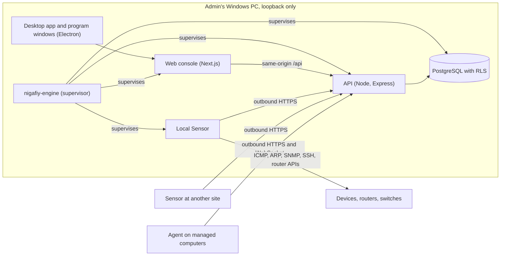

# Nigafiy

<!-- CI badge: repository-relative URL. It resolves once this repository is on GitHub and the
     workflow has run; it was not checked before the first push. -->
[](../../actions/workflows/ci.yml)

**English** | [العربية](README.ar.md)

Nigafiy is a free, Windows-first network and endpoint management platform for IT administrators and
MSPs. Seven programs share one local engine: it finds and monitors every device on the network,
explains incidents with deterministic, evidence-backed rules, controls routers, switches and DNS
access, and manages and supports company computers (Windows, Linux, macOS) through an enrolled agent
with remote desktop, files, shell and patching. Data stays on the organization's own machines; there is
no AI anywhere and no cloud control panel. The interface is in English and Arabic (full RTL), in light
and dark themes.

## The programs

| Program | Job | Main screens |
| --- | --- | --- |
| **Nigafiy Hub** | Home, sign-in, settings and the engine | Overview, global search, Sensors, programs, settings, system self-check, MSP portfolio |
| **Nigafiy Radar** | See every device on the network | Devices, discovery and scopes, topology, IPAM, switch ports |
| **Nigafiy Watch** | Monitor, and understand what went wrong | Monitoring, incidents, events, Network Doctor, insights, Time Machine, impact, reports, notifications, maintenance |
| **Nigafiy Guard** | Protect and control the network | Security checks, DNS access control, routers, port control, config backup |
| **Nigafiy Fleet** | Manage and support company computers | Endpoints, remote sessions, policies, approvals |
| **Nigafiy Mind** | Knowledge, playbooks and automation | Knowledge, playbooks, automation |
| **Nigafiy Toolbox** | Quick network tools | Ping, TCP port, common ports, DNS, reverse DNS, traceroute, subnet calculator |

Two more components run on other machines: the **Nigafiy Sensor** (network collector, one per site;
the Hub runs one locally) and the **Nigafiy Agent** (on each managed computer). The program list is
defined once in [`packages/shared-types/src/programs.ts`](packages/shared-types/src/programs.ts).
Feature details: [docs/features/capabilities.md](docs/features/capabilities.md).

## Architecture



The server never opens a connection into a customer network: Sensors and Agents dial out and poll for
commands from a closed list. More diagrams (ports, discovery, enrollment, remote desktop, router
changes, config restore, updates, distribution, sign-in) are in
[docs/architecture/flowcharts.md](docs/architecture/flowcharts.md); the written architecture is in
[docs/architecture/overview.md](docs/architecture/overview.md).

## Quick start

**Prerequisites:** Node.js 24+, Go 1.27.3+ (pnpm 10 is installed for you by `pnpm local` when missing).
No Docker, PostgreSQL or Redis needed.

```bash
pnpm local
```

On Windows you can double-click `Start Nigafiy.cmd` instead. The first run installs dependencies,
creates `.env`, starts the database, API and web app on this computer, asks you to confirm your
network, creates your account and opens http://localhost:3100.

Development, with each part in its own terminal:

```bash
pnpm install
cp .env.example .env      # then set APP_ENCRYPTION_KEY and the lan_app password
pnpm dev:db               # PostgreSQL on 5433
pnpm dev:api              # API on 4100
pnpm dev:web              # web on 3100
```

The gate every change passes:

```bash
pnpm typecheck
pnpm lint
pnpm check:brand
pnpm test                 # API integration tests, real PostgreSQL + RLS
pnpm test:collector       # Sensor (Go)
pnpm test:agent           # Agent (Go)
pnpm test:engine          # Engine (Go)
pnpm build
```

The desktop installer, the Sensor on another machine, every build target and every test command:
[docs/getting-started.md](docs/getting-started.md).

## Repository map

| Path | What it is |
| --- | --- |
| [`apps/api`](apps/api) | API: Node 24 (native TypeScript), Express 5, Zod, PostgreSQL with Row Level Security, background jobs |
| [`apps/web`](apps/web) | Web console for all seven programs: Next.js 16, React 19, Tailwind 4, EN + AR |
| [`apps/desktop`](apps/desktop) | Windows desktop app (Electron): program windows, tray, local mode, NSIS / MSI / MSIX packaging |
| [`engine`](engine) | `nigafiy-engine` (Go): supervises database, API, web and Sensor; Windows service; control API; update helper; program launchers |
| [`collectors/lan-collector`](collectors/lan-collector) | The Sensor (Go): discovery, checks, SNMP, DNS filter, router drivers, config backup, Toolbox |
| [`agents/endpoint-agent`](agents/endpoint-agent) | The Agent (Go) for Windows, Linux and macOS, plus Quick Support (`nigafiy-support`) |
| [`packages/shared-types`](packages/shared-types) | API contract types, program list and route table shared by API and web |
| [`packages/brand`](packages/brand) | Logo, program icons and colour tokens |
| [`packaging`](packaging) | Endpoint agent NSIS script |
| [`scripts`](scripts) | `pnpm local`, brand check, e2e smoke, installers, release and signing scripts |
| [`docs`](docs) | Architecture, features, operations, security, roadmap |
| [`.github`](.github) | CI workflow, issue and pull request templates |

## Documentation and status

- [Documentation index](docs/README.md)
- [Project status: what is built, what ran on real hardware, what is tested only](docs/roadmap/status.md)
- [Security model](docs/security/model.md) and [how to report a vulnerability](SECURITY.md)
- [Contributing (internal workflow)](CONTRIBUTING.md)

**Honest status.** Many features have only been exercised against protocol test doubles, fixtures or
loopback, not on real hardware: for example 15 of the 16 router drivers, SNMP switches, SSO, config
restore, the agent on Linux and macOS, the engine's Windows service mode and the MSI / agent installers.
The GitHub CI workflow has never run. [docs/roadmap/status.md](docs/roadmap/status.md) lists exactly
what ran for real and what did not.

## License

Not yet chosen: all rights reserved until then.
