# Flowcharts: how Nigafiy really works

Each diagram shows a flow that exists in the code today, with links to where it lives. Where a flow has
only been exercised by tests, the section says so; [../roadmap/status.md](../roadmap/status.md) has the
full "real hardware versus tests only" table.

Contents:

1. [System components and ports](#1-system-components-and-ports)
2. [Discovery to inventory, events, incidents and notifications](#2-discovery-to-inventory-events-incidents-and-notifications)
3. [Endpoint agent enrollment and command delivery](#3-endpoint-agent-enrollment-and-command-delivery)
4. [Remote desktop: connect, consent, transports, recording](#4-remote-desktop-connect-consent-transports-recording)
5. [A router change with read-back and capability refusal](#5-a-router-change-with-read-back-and-capability-refusal)
6. [Configuration backup and restore safety](#6-configuration-backup-and-restore-safety)
7. [Signed update flow](#7-signed-update-flow)
8. [Distribution channels](#8-distribution-channels)
9. [Sign-in: local, MFA, SSO and throttling](#9-sign-in-local-mfa-sso-and-throttling)

---

## 1. System components and ports

On the admin's PC everything listens on loopback. The engine supervises the database, API, web console
and (in service mode) the Sensor as separate child processes, each in its own Windows Job Object. When
the desktop app has to start the engine itself, it starts `nigafiy-engine run --no-sensor` and runs the
Sensor on its own, as before. Sensors and Agents always dial out to the API; the API never connects
into them. Port numbers shown are the installed app; the dev stack (`pnpm dev:*`) uses 3100 / 4100 / 5433.

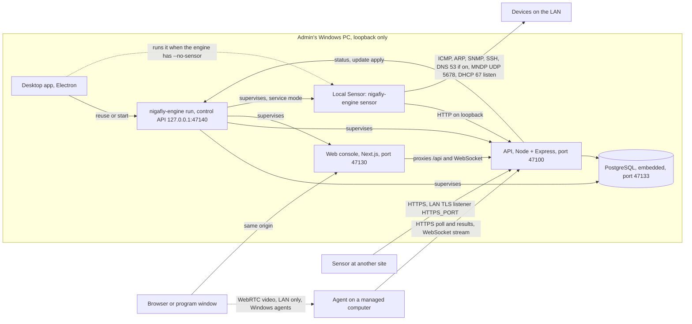

Code: [engine supervisor](../../engine/internal/supervisor), [engine control API](../../engine/internal/control),
[desktop engine-stack.cjs](../../apps/desktop/src/engine-stack.cjs),
[collector-manager.cjs](../../apps/desktop/src/collector-manager.cjs), [scripts/local.mjs](../../scripts/local.mjs),
[API app.ts](../../apps/api/src/app.ts), [web proxy.ts](../../apps/web/proxy.ts),
[LAN TLS](../../apps/api/src/infrastructure/lan-tls.ts). Docs: [desktop/engine.md](../desktop/engine.md),
[engine-sensor.md](engine-sensor.md), [features/lan-tls.md](../features/lan-tls.md).
Tested only: the engine as a Windows service and LAN TLS from a second computer.

---

## 2. Discovery to inventory, events, incidents and notifications

The Sensor sweeps only its authorized scopes, writes every batch to an on-disk spool and uploads it to
`/api/v1/collector/telemetry`. Ingest updates the inventory and emits events. `emitEvent` checks
maintenance windows, stores the event with its evidence, queues a delivery per matching channel (not
during maintenance), hands the event to correlation (incidents) and pings the SSE stream. Background
jobs, each single-runner through a PostgreSQL advisory lock, send the notifications and escalations.

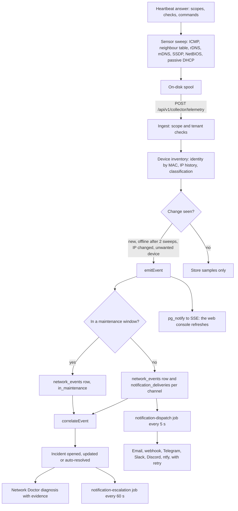

Code: [Sensor discovery](../../collectors/lan-collector/internal/discovery),
[spool](../../collectors/lan-collector/internal/spool),
[ingest/discovery/process-run.ts](../../apps/api/src/modules/ingest/discovery/process-run.ts),
[offline.ts](../../apps/api/src/modules/ingest/discovery/offline.ts),
[events/emit.ts](../../apps/api/src/modules/events/emit.ts),
[correlation/engine.ts](../../apps/api/src/modules/correlation/engine.ts),
[doctor](../../apps/api/src/modules/doctor),
[notifications/dispatch.ts](../../apps/api/src/modules/notifications/dispatch.ts),
[escalation.ts](../../apps/api/src/modules/notifications/escalation.ts),
[realtime](../../apps/api/src/modules/realtime). Discovery ran on a real LAN; incidents and diagnoses
have only seen test telemetry (no real outage happened), and Telegram/Slack/Discord/ntfy only local test
servers.

---

## 3. Endpoint agent enrollment and command delivery

An admin creates the endpoint and gets a single-use `ldea_` token (only its SHA-256 is stored). The Agent
exchanges it once for a per-endpoint credential `lda_<id>.<secret>` and keeps it in its state file.
Commands are checked for role and platform before they are queued. Inserting a command fires
`pg_notify('ld_agent_wake')`, which wakes the Agent's long poll on whichever API instance holds it.
Delivery is **at most once**: the API marks the row `delivered` as it hands it out and never hands it out
again (a repeated "restart this computer" would be a reboot loop), and the Agent also skips any command
id it has already seen.

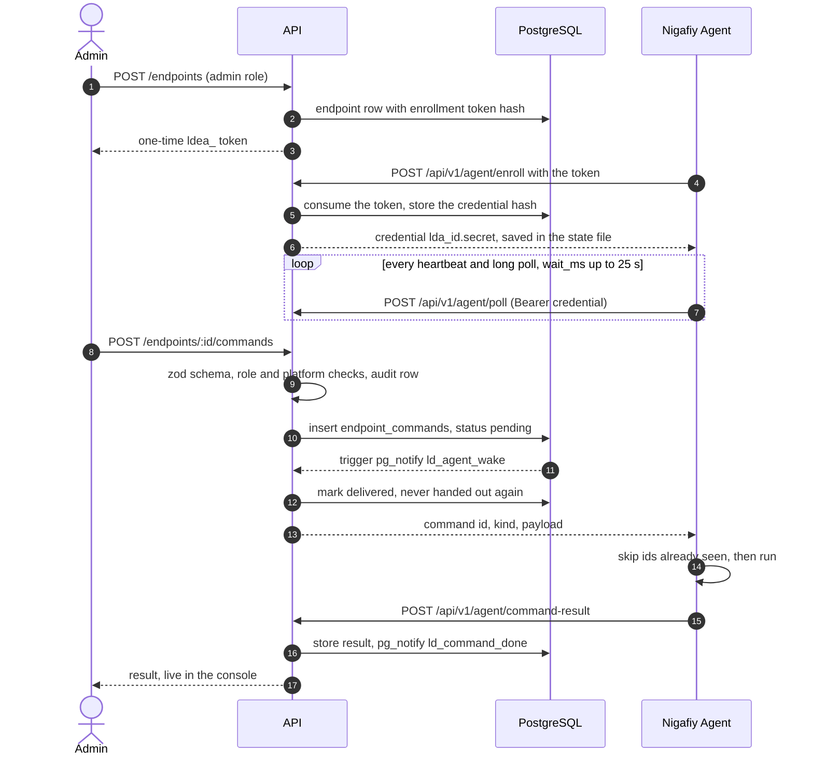

Remote sessions add an access policy on top. `POST /remote-desktop/start` evaluates it in this order,
and every refusal is audited as `fleet.policy_refused` in its own transaction:

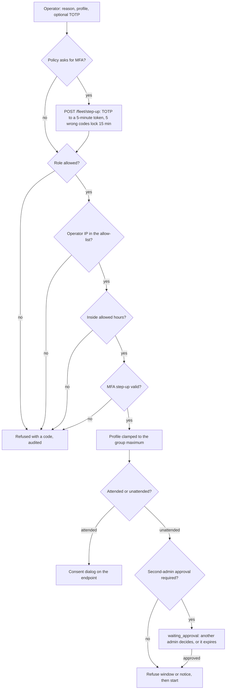

Code: [enrollment](../../apps/api/src/modules/endpoints/enrollment/service.ts),
[agent gateway routes](../../apps/api/src/modules/endpoints/agent/routes.ts),
[agent service.ts](../../apps/api/src/modules/endpoints/agent/service.ts),
[repo.ts deliverPendingCommands](../../apps/api/src/modules/endpoints/repo.ts),
[commands/guards.ts](../../apps/api/src/modules/endpoints/commands/guards.ts),
[migration 033](../../apps/api/src/database/migrations/033_agent_long_poll_wake.sql),
[Agent agent.go](../../agents/endpoint-agent/internal/agent/agent.go),
[fleet-policy](../../apps/api/src/modules/endpoints/fleet-policy) (`enforce.ts`, `step-up.ts`, `approvals.ts`).
Docs: [features/fleet-pro.md](../features/fleet-pro.md). The Windows agent ran for real against the API;
policy branches, approvals and MFA step-up are covered by API tests.

---

## 4. Remote desktop: connect, consent, transports, recording

A session opens only after the policy above. Under the `prompt` policy the hub sends the Agent zero
viewers until the user's consent is recorded, so no frame leaves before consent. The default picture
path is WebSocket binary frames with JPEG tiles, relayed in memory and never stored; if the socket fails
or stays waiting for more than 6 s, the console falls back to one JPEG per HTTP command. On Windows
agents the browser can offer WebRTC (H.264, direct on the LAN, no TURN), signalled over the existing
sockets; any failure falls back to JPEG. Recorded sessions always stay on the server path.

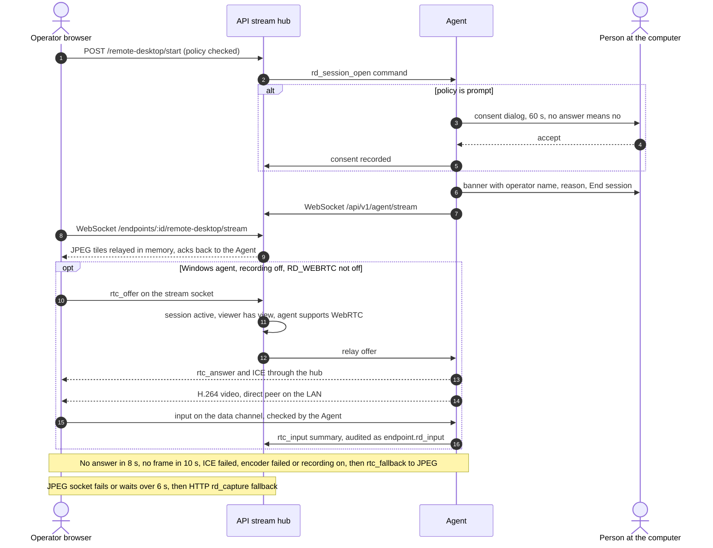

Recording, when the group rule is `required` or the holder switches it on:

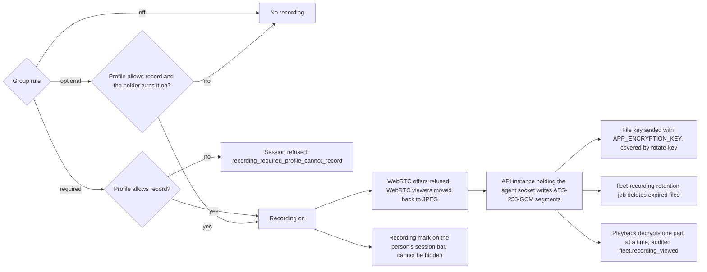

Code: [stream-hub.ts](../../apps/api/src/modules/endpoints/remote-desktop/stream-hub.ts),
[sessions.ts](../../apps/api/src/modules/endpoints/remote-desktop/sessions.ts),
[recording.ts](../../apps/api/src/modules/endpoints/remote-desktop/recording.ts),
[frames.ts](../../apps/api/src/modules/endpoints/remote-desktop/frames.ts),
[Agent rdstream](../../agents/endpoint-agent/internal/rdstream) (`webrtc.go`),
[remotedesktop](../../agents/endpoint-agent/internal/remotedesktop),
[videoenc](../../agents/endpoint-agent/internal/videoenc), [userui](../../agents/endpoint-agent/internal/userui).
Docs: [features/fleet-pro.md](../features/fleet-pro.md). Real here: the consent dialog's 60 s timeout on
Windows and Media Foundation H.264 encoding of a real screen capture. Never run: WebRTC in a real browser
or between two computers.

---

## 5. A router change with read-back and capability refusal

Every router control is an explicit admin request, queued for the site's own Sensor, audited, and
re-read from the router afterwards, so the UI shows what the router really did. A control the driver
does not report as supported is refused before anything is queued, and the Sensor refuses it again if
it ever arrives.

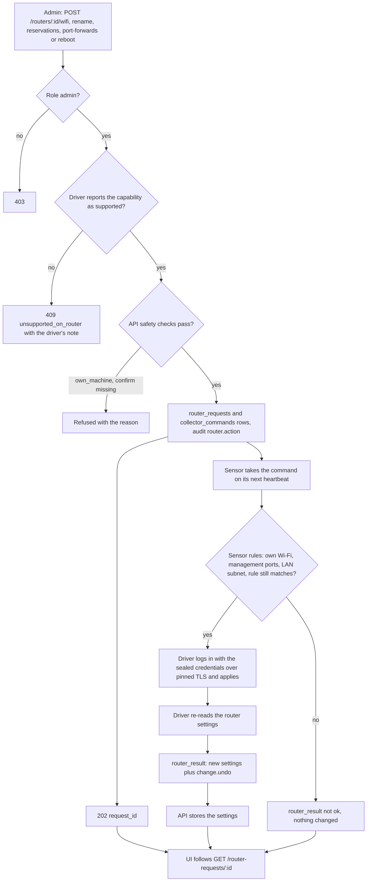

Code: [routers/control.ts](../../apps/api/src/modules/routers/control.ts),
[routers/controls.ts](../../apps/api/src/modules/routers/controls.ts),
[routers/routes.ts](../../apps/api/src/modules/routers/routes.ts),
[Sensor agent/routers.go](../../collectors/lan-collector/internal/agent/routers.go),
[router drivers](../../collectors/lan-collector/internal/router). Docs:
[features/router-controls.md](../features/router-controls.md). Real: the Zyxel VMG3625-T50B (block,
unblock, rename, reserve, port forward, guest Wi-Fi). The other 15 drivers, including the Cisco IOS XE
controls over RESTCONF (IOS XE 16.6+: block, schedule, rate limit, reservations, static-NAT port
forwards), only against pinned-TLS protocol test doubles.

---

## 6. Configuration backup and restore safety

Restore is offered only for vendors whose device rolls a change back by itself: **Juniper Junos**
(`commit confirmed N`) and **Cisco IOS XE** (`configure replace … force revert trigger error timer N`,
then `configure confirm`). Every other vendor shows "Restore not supported". The device's identity is
checked three ways: its pinned SSH host key (a restore never trusts a key on first use), the admin
typing the device name, and the version's own host name, which must match the latest backup's unless
the admin forces it with a second typed confirmation.

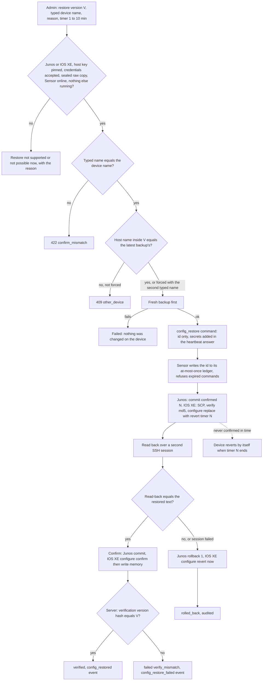

Code: [configbackup/restore.ts](../../apps/api/src/modules/configbackup/restore.ts),
[Sensor configbackup/restore.go](../../collectors/lan-collector/internal/configbackup/restore.go),
[restore_iosxe.go](../../collectors/lan-collector/internal/configbackup/restore_iosxe.go),
[agent/configrestore.go](../../collectors/lan-collector/internal/agent/configrestore.go). Docs:
[features/config-backup.md](../features/config-backup.md). Tested only, against SSH (and SCP) test
doubles of the Junos and IOS XE CLIs; it has never run against a real Junos or IOS XE device.

---

## 7. Signed update flow

Nothing is installed in the background. The manifest is signed with Ed25519; the installer it names is
checked for size, SHA-256 and (when `NIGAFIY_UPDATE_PUBLISHER_THUMBPRINT` is set) its Authenticode
publisher, again at each step. An owner or admin confirms the install.

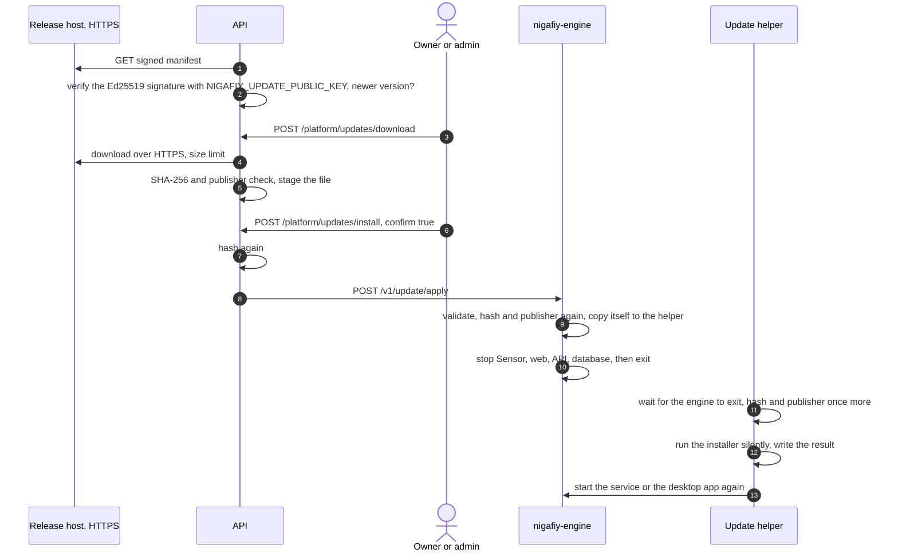

Code: [platform/updates.ts](../../apps/api/src/modules/platform/updates.ts),
[engine/internal/update](../../engine/internal/update), [scripts/release](../../scripts/release).
Docs: [operations/updates.md](../operations/updates.md). Tested only with signed test manifests: no
update source or signing key exists yet. MSI installs are updated through GPO/Intune instead, and Store
installs by the Store.

---

## 8. Distribution channels

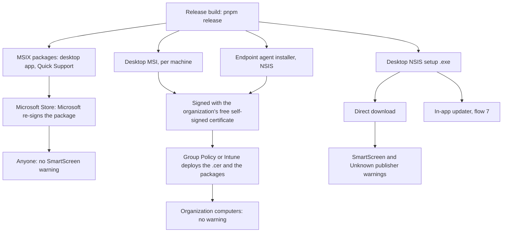

Code: [apps/desktop/scripts/build-msix.cjs](../../apps/desktop/scripts/build-msix.cjs),
[scripts/installers](../../scripts/installers), [packaging/endpoint-agent](../../packaging/endpoint-agent),
[scripts/signing](../../scripts/signing). Docs: [operations/installers.md](../operations/installers.md),
[operations/microsoft-store.md](../operations/microsoft-store.md),
[operations/code-signing.md](../operations/code-signing.md). Ran here: NSIS install, upgrade and
uninstall in a scratch folder; MSI, agent installer and MSIX built and signed with a test certificate.
Never run: an MSI install, the agent installer, installing an MSIX package, a Store submission.

---

## 9. Sign-in: local, MFA, SSO and throttling

Local sign-in always runs one scrypt verification, so response time does not reveal whether the
account exists. Credential routes are limited per client IP (10 a minute; counters shared through Redis
when `REDIS_URL` is set). MFA failures are counted **per account**: 5 wrong codes lock the account's MFA
for 15 minutes. SSO is an extra way in per organization, not a replacement.

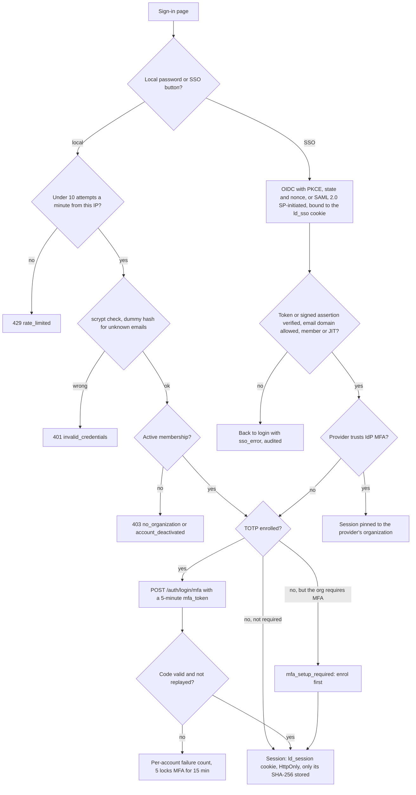

Code: [auth/routes.ts](../../apps/api/src/modules/auth/routes.ts),
[auth/mfa.ts](../../apps/api/src/modules/auth/mfa.ts),
[auth/session.ts](../../apps/api/src/modules/auth/session.ts),
[auth/sso](../../apps/api/src/modules/auth/sso) (`oidc.ts`, `saml.ts`),
[rate-limit-store.ts](../../apps/api/src/infrastructure/rate-limit-store.ts). Docs:
[security/model.md](../security/model.md), [features/sso.md](../features/sso.md). SSO has only run
against in-test identity providers.
